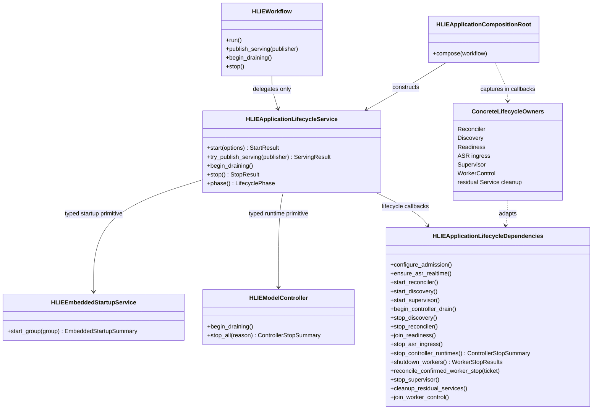
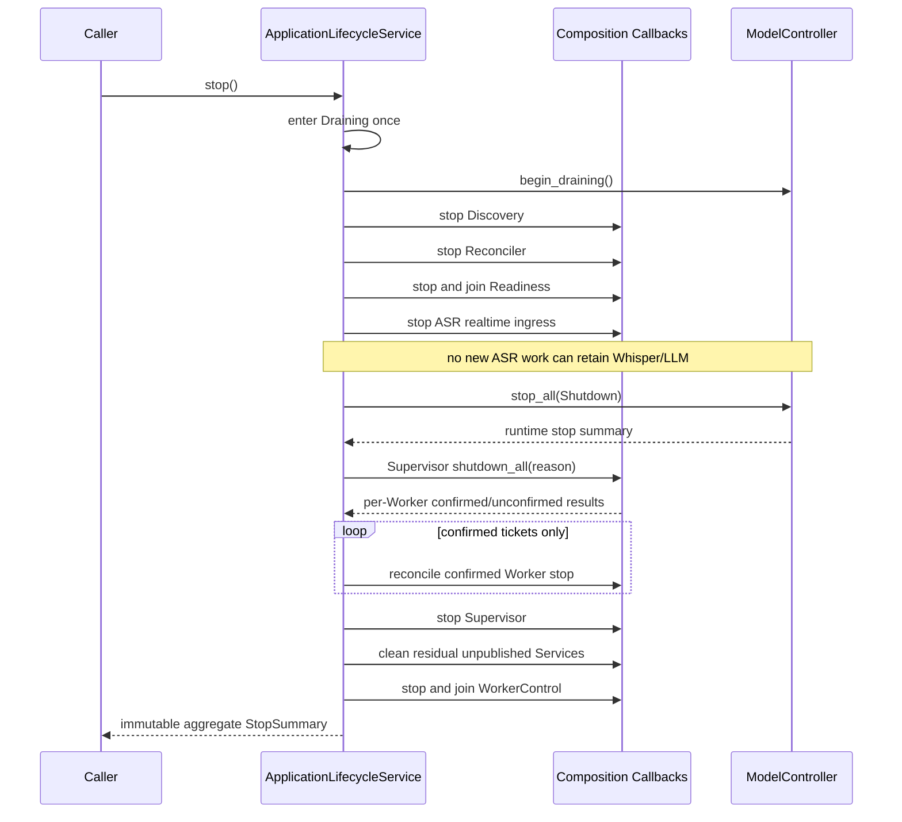
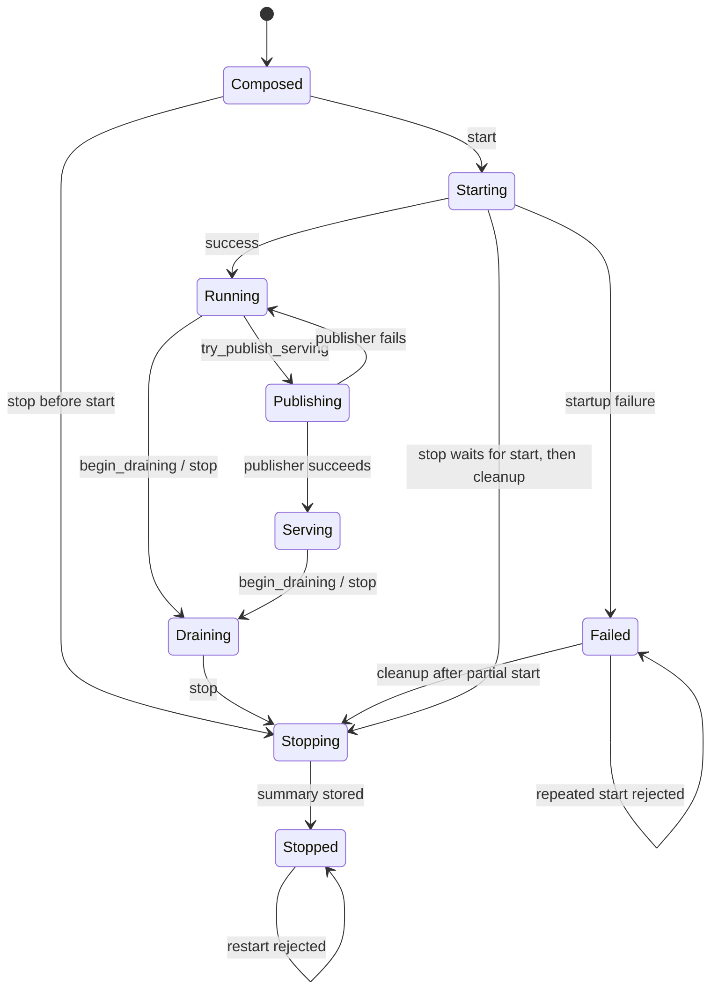

# P1-7 Application Lifecycle Service

`HLIEApplicationLifecycleService` is the single application-layer owner of
runtime startup and shutdown ordering. It provides one-shot startup, explicit
draining, and idempotent concurrent stop. `HLIEWorkflow` delegates to this
service; it no longer coordinates individual control-plane or model-lifetime
components.

The boundary is callback-driven. Composition translates concrete services
into narrow lifecycle operations, while this service owns ordering, state,
failure aggregation, and concurrency. It has no transport, configuration
format, global Singleton, TCIM, GGML, or concrete model Service dependency.

## Class Boundary



The embedded startup and Controller contracts are stable application-layer
primitives. Supervisor, Reconciler, Discovery, Readiness, ASR ingress,
WorkerControl, ServiceManager, and ProcessManager stay behind callbacks. This
prevents the lifecycle coordinator from becoming a second composition root.

## Startup Sequence

```mermaid
sequenceDiagram
    participant W as Workflow
    participant L as ApplicationLifecycleService
    participant E as EmbeddedStartupService
    participant C as Composition Callbacks

    W->>L: start(process role + admission limits)
    L->>L: validate every required dependency
    L->>E: start_group(Primary)
    E-->>L: primary summary
    alt primary requests abort
        L-->>W: Failed summary; later stages untouched
    else primary accepted
        L->>C: configure admission
        L->>E: start_group(Secondary)
        L->>C: ensure ASR realtime ingress
        L->>C: start Reconciler
        opt main process only
            L->>C: start Discovery
            L->>C: start Supervisor
        end
        L-->>W: Running summary
    end
```

Dependency validation completes before the first mutating callback. Primary
embedded startup remains the abort boundary inherited from the existing
workflow. Admission is configured before secondary Services can accept work.
Reconciliation starts before main-process Discovery and Worker supervision so
subsequent observations have an active convergence owner. Worker processes do
not start Discovery or Supervisor.

`Running` means the internal runtime graph is ready. AppController then calls
`try_publish_serving()` to publish WebService, balancer, and its local running
flag as one gated operation. The gate prevents `stop()` or draining from
observing a partially published server; a stop that arrives first causes the
publisher to be rejected without starting HTTP.

## Shutdown Sequence



ASR ingress must stop before Controller Runtime destruction. A realtime ASR
task can retain or call both Whisper and LLM; reversing this order permits a
use-after-destruction race even when individual model stops appear correct.

Controller-owned Runtime handles stop before WorkerSupervisor-owned processes.
Only a confirmed Worker stop may reconcile its launch ticket as stopped.
Unconfirmed ownership is an `ERROR` and remains visible in the aggregate
summary; reservations must not be released on an assumption.

The residual cleanup callback is a temporary compatibility adapter and final
safety net. Embedded startup now attempts to stop and detach a ServiceManager
slot immediately when a target cannot publish a Runtime. The shutdown callback
is still needed for partial initialization or failures outside that transaction
where immediate cleanup was unavailable or unconfirmed. It must not stop a
published Runtime a second time or become a permanent parallel ownership path.
As every initialization path gains an explicit rollback transaction, this
adapter should become an empty assertion/metric and eventually disappear.

## State And Concurrency Contract



- exactly one caller executes startup callbacks;
- all required callbacks are validated before startup side effects;
- draining is monotonic and calls Controller drain at most once;
- exactly one caller executes shutdown callbacks;
- serving publication is serialized with draining; concurrent stop callers
  wait for the publication gate before tearing down HTTP and runtimes;
- a stop arriving during startup waits for startup to settle, then tears down
  everything that may have started;
- concurrent and repeated stop callers wait when necessary and receive the
  same stored summary, rather than a synthetic success;
- neither failed nor stopped instances can restart. A new object graph is
  required for a new lifecycle.

Lifecycle callbacks must not call back into `start()`, `begin_draining()`, or
`stop()` on the same instance. Normal startup/shutdown callbacks execute
outside the state mutex. The serving publisher uses a dedicated publication
gate while the state mutex remains free, so concurrent stop can wait without
deadlocking. State transitions and the immutable final summary are published
under the mutex and waiters are released through a condition variable.

## Failure And Ownership Matrix

| Condition | Required behavior | Ownership consequence |
|---|---|---|
| required dependency missing | `ERROR`, fail before any callback | no resource acquired |
| Primary embedded abort | stop startup immediately | partial Primary state remains eligible for cleanup |
| later startup stage fails | store failed start summary; reject restart | `stop()` still cleans all possibly-started owners |
| stop before start | produce and store an empty terminal summary | no startup permitted afterward |
| concurrent stop | wait for the active stop and return its summary | callbacks execute once |
| Controller Runtime stop incomplete | continue shutdown and return incomplete | Controller/reservation ownership remains unconfirmed |
| Worker process stop confirmed | reconcile the exact launch ticket | Registry may publish confirmed stop |
| Worker process stop unconfirmed | `ERROR`, do not reconcile ticket | ownership and reservation remain retained |
| initialized but unpublished Service slot | run residual compatibility cleanup once | no duplicate Controller Runtime stop |
| cleanup callback fails | continue remaining independent cleanup | aggregate summary records the failed stage |

Shutdown is best-effort across independent owners, but never reports complete
when Runtime or Worker ownership is unconfirmed. One failed cleanup stage must
not prevent later joins that protect process exit.

## Logging And Security

- `INFO`: real one-time transitions to Running, Serving, Draining, and Stopped,
  with bounded aggregate counts;
- `DEBUG`: Worker skips for main-only stages, duplicate drain calls, and stop
  callers waiting for the active owner;
- `WARN`: recoverable timeout or partial cleanup where ownership is still
  known;
- `ERROR`: missing required dependency, invalid transition, startup failure,
  callback exception, or unconfirmed Runtime/Worker ownership.

Do not log from polling/wait loops. Logs may contain lifecycle state, process
role, bounded counts, model key, Runtime id, and generation where needed for
ownership diagnosis. They must never contain prompt, transcript, response
body, uploaded content, API key, launch token, or manifest content.

## Verification And Guardrail

Focused tests cover dependency-validation side-effect freedom, exact main and
Worker startup ordering, Primary abort, startup failure, stop-before-start,
ASR-before-Runtime shutdown ordering, ownership failure propagation, residual
unpublished cleanup, idempotent drain, concurrent start/stop single execution,
identical stop summaries, callback-exception continuation, and permanent
restart rejection in 13 cases and 59 assertions. `HLIEWorkflow::run()` returns
a typed success flag; AppController must not register or start WebService after
lifecycle startup failure. Residual native stop and Worker status-publication
confirmation remain separate fields in the shutdown aggregate.

Windows Release product and both unit targets build successfully. Full Release
CTest passes 31/31, including WorkerSupervisor and Mirage components; SDK-free
CTest passes 29/29.

`hlie.architecture.application-lifecycle-service-dependencies` rejects direct
dependencies on Workflow, HTTP/JSON, ServiceManager, ProcessManager,
DeviceService, concrete model Services, Supervisor, Reconciler, Discovery,
Readiness, WorkerControl, Singleton, TCIM, or GGML. It also rejects lifecycle
orchestration calls returning to Workflow and requires construction by
`HLIEApplicationCompositionRoot`.
