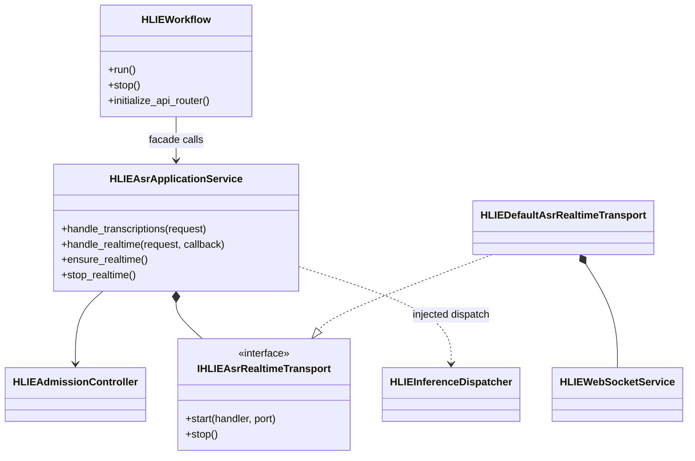
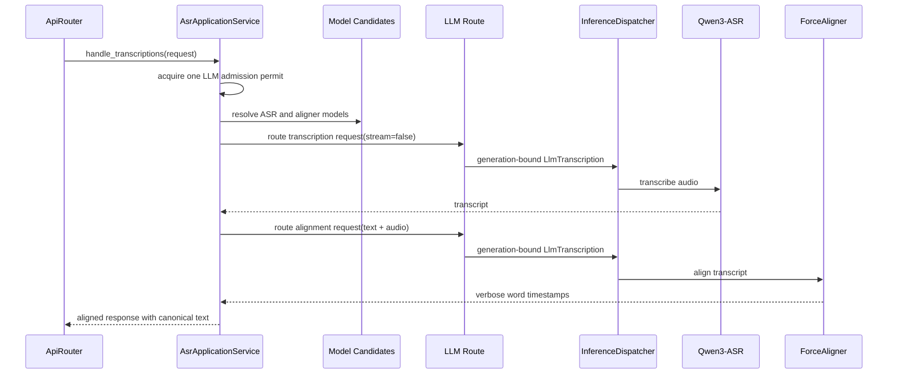
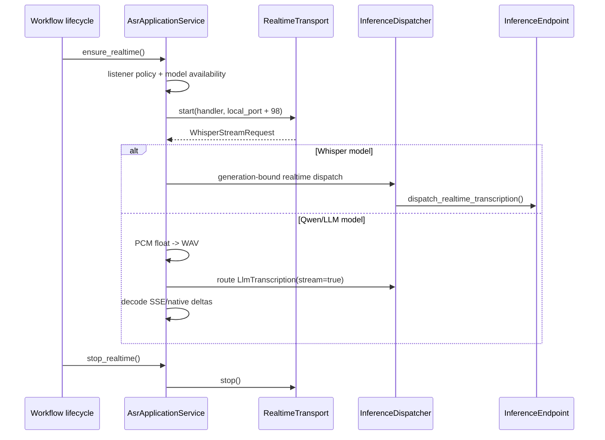

# P1-7 ASR Application Service

`HLIEAsrApplicationService` owns ASR request orchestration and realtime
listener lifecycle. It preserves the existing Whisper and Qwen3-ASR behavior
while removing model selection, the two-stage word timestamp pipeline, audio
conversion, streaming decode, and WebSocket ownership from `HLIEWorkflow`.

The service is an app-layer boundary for the current HOUMO implementation. It
is not a second inference engine or a multi-SDK provider abstraction.

## Ownership

The service owns:

- direct Whisper versus LLM transcription selection;
- Qwen3-ASR and ForceAligner discovery/selection;
- ASR transcription followed by force alignment for word timestamps;
- LLM admission across the complete two-stage request;
- PCM float-to-WAV adaptation for realtime LLM transcription;
- Qwen streaming response decode and delta delivery;
- realtime listener idempotent start/stop and the historical `7901 -> 7999`
  port mapping.

It does not own Controller state, Runtime publication, request lease
accounting, concrete Whisper/LLM services, uWebSockets, or model loading.
Generation-bound dispatch remains in `HLIEInferenceDispatcher`; model
readiness/auto-load remains behind the existing LLM route callback.

`WhisperStreamRequest` and language normalization now live in the neutral
`hlie_asr_realtime_contract.h`; neither the ASR application service nor the
Whisper model-service header needs to include the uWebSockets implementation.

## Word Timestamp Sequence

The same admission permit covers both backend calls. Direct LLM
transcriptions keep the permit until the returned response/stream is destroyed
through `HLIEAdmissionGuardedResponse`.

## Realtime Sequence

Dynamic Workers do not create the process-global realtime listener. Masters
and replica ports retain the previous listener policy and isolated port
mapping.

## Logging And Verification

- `DEBUG`: successful per-request backend selection, pipeline selection, and
  completed realtime transcription.
- `INFO`: realtime listener start and stop lifecycle transitions.
- `WARN`: admission rejection, unavailable target, or final/delta mismatch.
- `ERROR`: null/failed backend responses, missing stream deltas, or transport
  creation failure.

Failure logs contain status and byte counts, not response bodies or transcript
text. The architecture gate
`hlie.architecture.asr-application-service-dependencies` prevents the service
from depending on Workflow, Controller, ServiceManager, concrete model
services, ProcessManager, DeviceService, WebSocket implementation, Singleton,
TCIM/GGML, or llama server response helpers. It also prevents ASR ownership
from returning to Workflow.

Focused tests cover direct Whisper dispatch, Qwen3-ASR plus ForceAligner
composition, canonical text merge, listener port mapping, idempotent start,
stop, and listener policy rejection.
