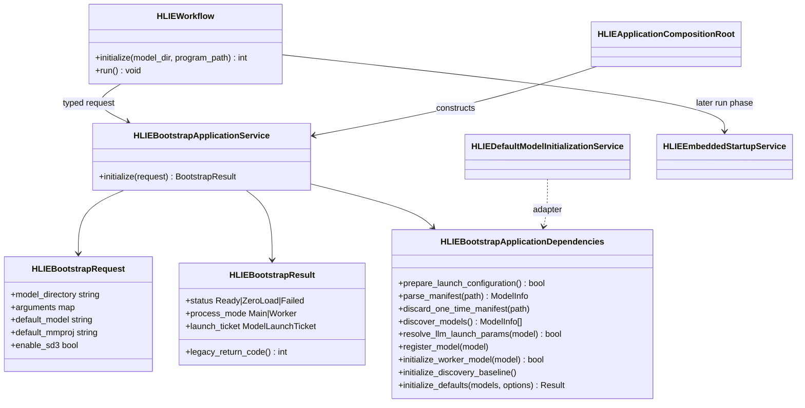
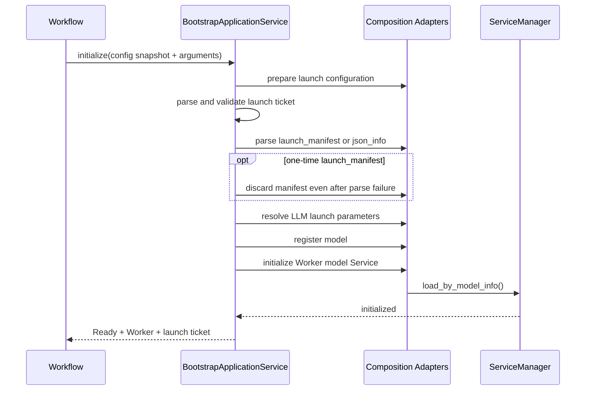
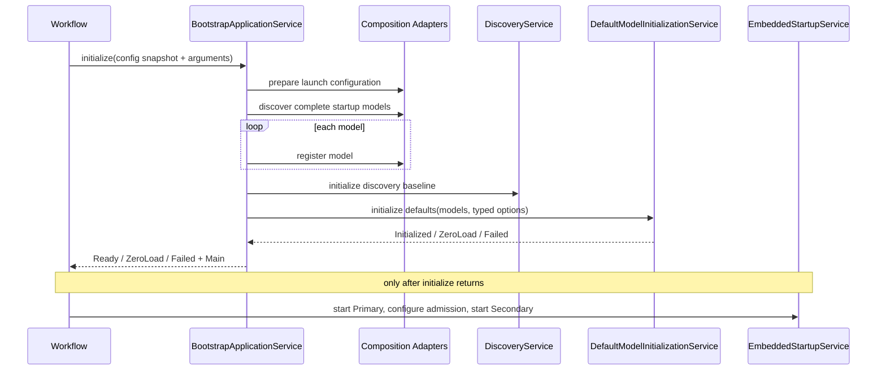

# P1-7 Bootstrap Application Service

`HLIEBootstrapApplicationService` owns the initialization state machine that
runs after the production object graph is composed and before Services are
started. It selects main versus Worker process bootstrap, validates launch
tickets, consumes launch manifests, registers the initial model catalog, and
delegates default Service initialization.

It does not read global configuration, scan the filesystem directly, mutate
Registry directly, construct a concrete Service, start a Runtime, or publish a
generation. Those operations remain behind composition adapters and the later
`HLIEEmbeddedStartupService` run phase.

## Class Boundary

The result keeps process role separate from startup status. A Worker can fail
initialization, and a main process can successfully enter zero-load mode. A
single boolean cannot represent these states without ambiguous error handling.

## Worker Sequence

The one-time manifest is consumed immediately after the parse attempt. This is
an ownership and security invariant: malformed or partially consumed launch
material must not remain available for a later retry. The legacy `--json_info`
path remains non-destructive for compatibility.

## Main-Process Sequence

Catalog registration happens before the discovery baseline and default model
selection. This preserves alias resolution and prevents the first background
scan from republishing the initial filesystem snapshot as a change.

## Compatibility Matrix

| Input/state | Result |
|---|---|
| invalid `--launch_generation/token/model_key` tuple | `Failed`, legacy `-1`, manifest is not opened |
| valid one-time Worker manifest | consume, resolve, register, initialize, `Ready` |
| malformed one-time Worker manifest | consume and return `Failed` |
| legacy `--json_info` | parse without deleting the source file |
| no Worker manifest | main-process discovery and default initialization |
| main process with no loadable default | `ZeroLoad`, legacy `8` |
| instance process with no loadable default | `Failed`, legacy `-1` |
| successful main or Worker initialization | `Ready`, legacy `0` |

`start_time` remains assigned by Workflow only for `Ready` and `ZeroLoad`.
`is_slave` and the launch ticket are copied from the typed result. Service
`run()` and Runtime publication are intentionally not part of this service.

## Logging And Security

- accepted ticket, parsed manifest, and Worker Service initialization are
  one-time lifecycle `INFO` events;
- invalid ticket/configuration, manifest parse, resolver, and Service
  initialization failures are `ERROR`;
- model discovery detail retains the existing owner-side DEBUG/INFO levels;
- launch token, prompt, transcript, response body, and model content are never
  logged.

## Verification And Guardrail

Focused full and SDK-free tests cover invalid-ticket short-circuiting,
ticketed Worker startup, one-time manifest consumption, legacy manifest
retention, main catalog ordering, zero-load mapping, instance failure,
launch-configuration failure, and missing required composition adapters in
7 cases and 59 assertions.

`hlie.architecture.bootstrap-application-service-dependencies` rejects direct
dependencies on Workflow, Controller, ServiceManager, ProcessManager,
WorkerSupervisor, DeviceService, concrete model Services, HTTP, Singleton,
TCIM, or GGML. It also prevents ticket/manifest orchestration from returning to
Workflow and requires composition-root construction.

Windows Release product and unit targets build successfully. Full Release
CTest passes 30/30, including control-plane stress, WorkerSupervisor component,
and Mirage; SDK-free CTest passes 28/28. The P0 stress startup wait was also
changed from a scheduler-sensitive fixed yield count to a two-second wall-clock
deadline; SDK-free and full Release stress filters each pass five consecutive
runs with 7628 assertions per run.
