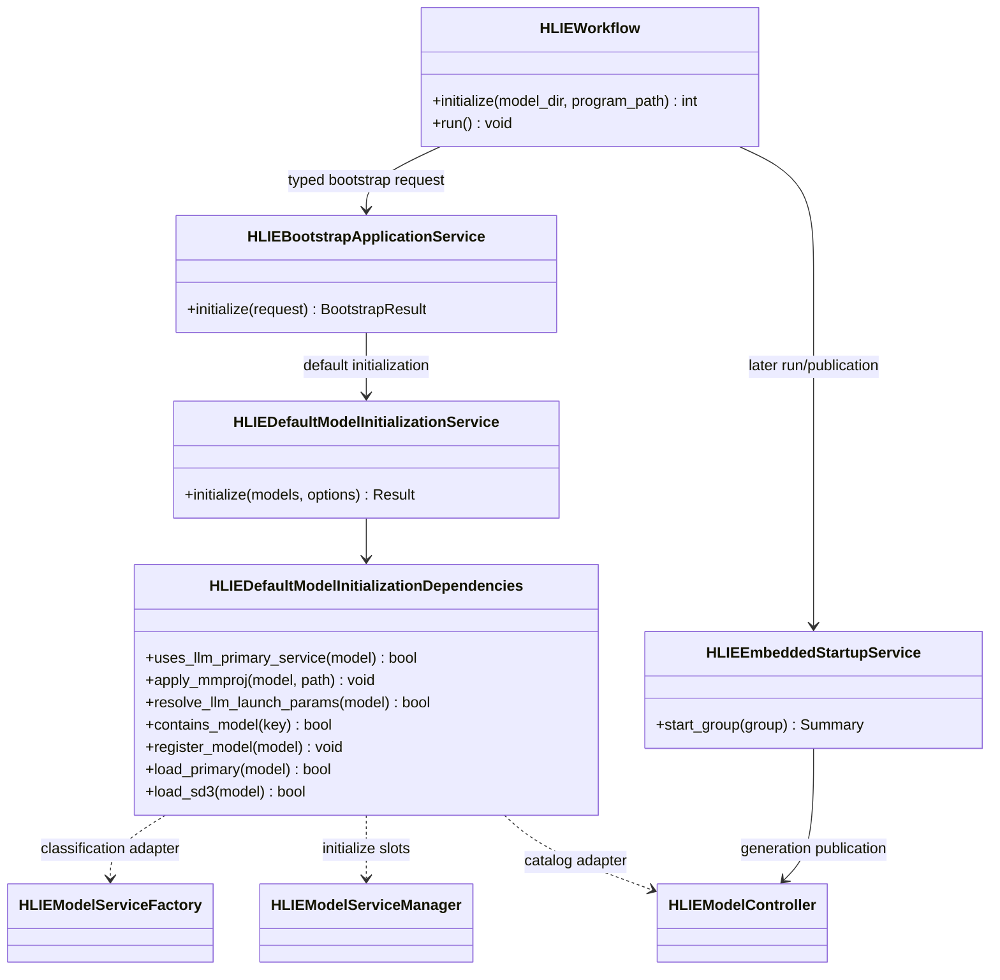
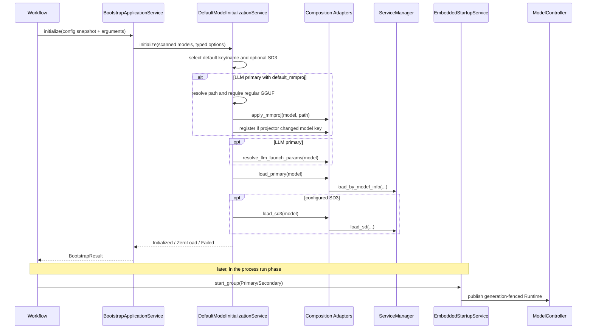

# P1-7 Default Model Initialization Service

`HLIEDefaultModelInitializationService` owns the legacy main-process startup
decision that runs after catalog scanning and before embedded Runtime
publication. It selects the configured primary model and optional SD3 model,
prepares LLM projector/launch parameters, and initializes the corresponding
ServiceManager slots.

This is deliberately not a second dynamic-load path. Runtime generation,
reservation commit/release, and runtime publication remain under the existing
Controller and `HLIEEmbeddedStartupService` contracts.

## Two-Stage Startup Contract

Startup is split into two explicit stages:

1. `HLIEDefaultModelInitializationService` selects and initializes concrete
   Services without calling `run()` or publishing a Runtime.
2. `HLIEEmbeddedStartupService` later starts initialized Services and publishes
   generation-fenced Embedded Runtimes through `HLIEModelController`.

The split preserves the established ordering in `HLIEWorkflow::run()`:
primary LLM/Document startup, admission configuration, secondary model
startup, then ASR realtime, Reconciler, Discovery, and WorkerSupervisor.

## Initialization Sequence

## Compatibility Matrix

| Inputs | Result |
|---|---|
| No valid models, main process | `ZeroLoad`; Workflow keeps legacy return `8` |
| No valid models, instance process | `Failed` |
| No default and SD3 disabled | Main may enter zero-load; instance fails |
| SD3 enabled with no configured default but SD3 absent | `Failed`, including main process |
| Configured default missing but SD3 present | Initialize SD3 only |
| LLM primary with `default_mmproj` | Append `.gguf`, resolve relative to model directory, validate, apply, then resolve LLM params |

The one-time Worker launch-manifest path is intentionally separate: it already
contains an exact model contract and is not default-model selection. Dynamic
HTTP/auto-load continues through `HLIEModelLoadService` and Controller-owned
reservations.

## Logging And Verification

Per-model scan observations are `DEBUG`. Successful selection and Service
initialization are lifecycle `INFO`; zero-load compatibility is `WARN`; missing
required models, invalid projector files, resolver failures, and initialization
failures are `ERROR`. Launch tokens, prompts, response bodies, and model content
are never logged.

The architecture gate prevents this service from depending on Workflow,
Controller/ServiceManager implementations, concrete model Services, HTTP/JSON,
Singleton configuration, ProcessManager, DeviceService, TCIM, or GGML. Unit
tests cover main/instance zero-load behavior, LLM projector preparation,
optional SD3 fallback, and the strict missing-SD3 branch in both full and
SDK-free targets. The focused slice passes 4 cases and 19 assertions in both
targets; Windows Release server/unit builds pass, full Release CTest is 23/23,
and `HLIE_TESTS_ONLY` CTest is 21/21.
