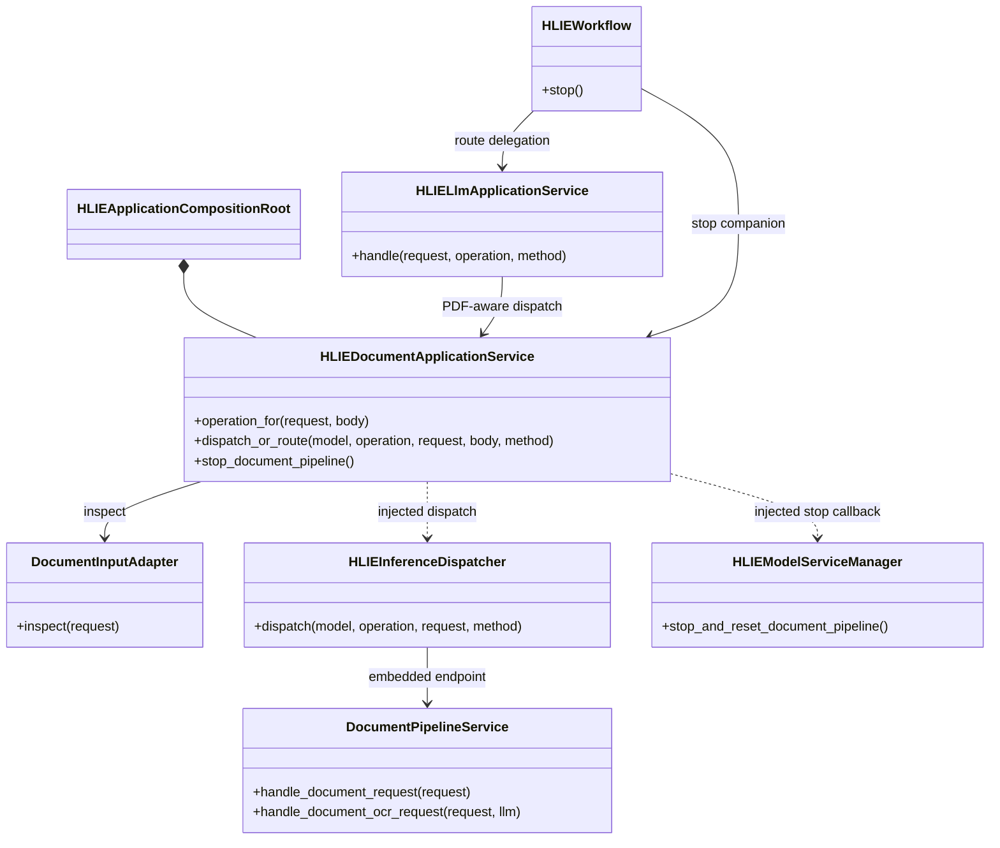
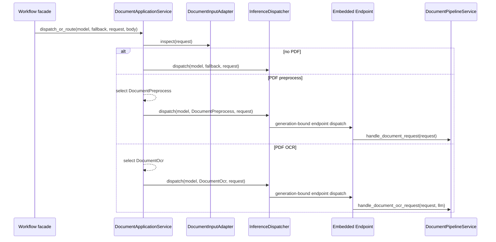

# P1-7 Document Application Service

`HLIEDocumentApplicationService` is the request-boundary owner for PDF routing.
It decides whether an otherwise normal LLM request is a document request and
selects `DocumentPreprocess` or `DocumentOcr`. The existing Dispatcher and
embedded endpoint continue to own the request lease and invoke
`DocumentPipelineService` directly, so the local path gains no HTTP hop and no
PDF payload copy.

## Ownership

The service owns:

- PDF inspection through `DocumentInputAdapter`;
- `document_preprocess_only` compatibility parsing;
- selection of `DocumentPreprocess` versus `DocumentOcr`;
- delegation to the generation-fenced inference dispatch callback;
- the lifecycle callback used to stop the LLM-owned document companion.

It does not own PDFium rendering, layout detection, crop policy, OCR prompts,
markdown merge, model readiness, Runtime publication, request leases, or model
service storage. Those responsibilities remain in their existing owners.

## Request Sequence

The Dispatcher still creates and guards the inference session before the
pipeline runs. Streaming/response teardown therefore preserves the P1-6 rule:
response first, endpoint/Runtime next, request lease last.

## Logging And Verification

PDF route observations are emitted through a callback owned by the composition
root and logged at `DEBUG`, because successful per-request routing is not a
lifecycle transition. Pipeline failures keep their existing `ERROR` logs in
`DocumentPipelineService`; no polling or repeated state log was added.

The architecture gate
`hlie.architecture.document-application-service-dependencies` prevents the
service from depending on Workflow, Controller, ServiceManager, concrete model
services, ProcessManager, DeviceService, Singleton, TCIM, GGML, or PDFium. It
also prevents PDF operation selection and document companion stop ownership
from returning to Workflow.

Focused tests cover non-document fallthrough, OCR selection, boolish preprocess
selection, dispatch delegation, and the lifecycle callback. Windows Release
and the SDK-free test slice both compile this production service.
