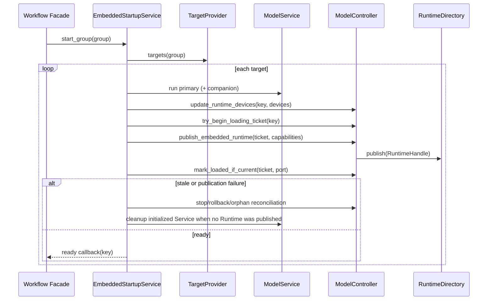

# P1-7 Embedded Startup Service

`HLIEEmbeddedStartupService` is the application-service boundary for the
legacy in-process startup path. It does not select models or construct
concrete Services. `HLIEDefaultEmbeddedStartupTargetProvider` adapts the
current ServiceManager slots into neutral startup targets.

## Ordering Contract

The existing order is intentionally preserved:

1. Start the primary LLM Service and its Document companion, then publish its
   Embedded Runtime.
2. Configure inference admission limits.
3. Start SD, Whisper, CosyVoice, and Qwen3-TTS targets, publishing each
   Embedded Runtime independently.
4. Start WebSocket, Reconciler, Discovery, and WorkerSupervisor.

The primary group can abort the remainder when its registered model instance is
missing, matching the previous LLM startup behavior. Secondary target failures
are logged and do not prevent other targets from starting.

## Runtime Publication Sequence

The service does not commit or release external reservations. Default embedded
startup retains its existing self-owned Service reservation compatibility path;
dynamic load transactions remain owned by ModelLoadService/ModelController.

When a target has already been started but cannot obtain a model ticket, cannot
find its registered model, or cannot publish a Runtime, the composition root
provides a narrow unpublished-target cleanup callback. That callback stops and
detaches the corresponding ServiceManager slot immediately. It prevents a
failed startup from leaving a live Service until process shutdown. The final
Lifecycle residual sweep remains as a last-resort safety net for failures that
occur outside this startup transaction or where cleanup could not be
confirmed; it is not the normal owner of embedded startup rollback.

## Boundaries and Verification

- `HLIEEmbeddedStartupService` has no HTTP, JSON, Workflow, ProcessManager,
  DeviceService, Singleton, TCIM, GGML, or concrete model-Service dependency.
- Workflow no longer contains concrete `ServiceManager->run()` branches or the
  `publish_initialized_runtime` lambda.
- The architecture gate
  `hlie.architecture.embedded-startup-service-dependencies` protects this
  ownership boundary and accepts the new Controller publication owner.
- Unit tests cover successful publication, primary missing-model abort, and
  RuntimeFactory failure reconciliation, including immediate cleanup of
  initialized-but-unpublished targets.
