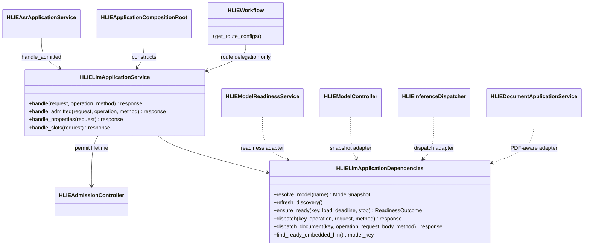
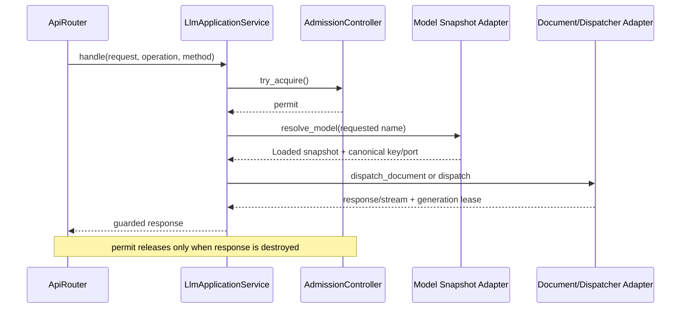
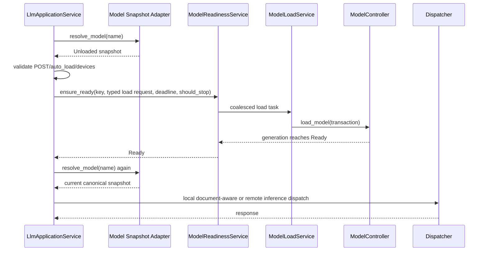
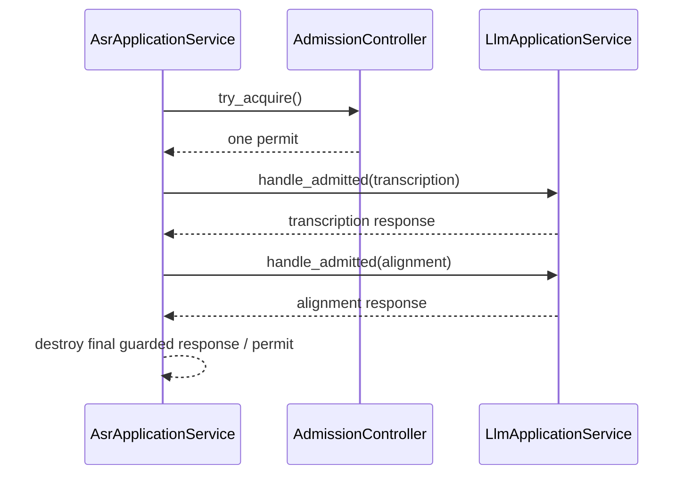

# P1-7 LLM Application Service

`HLIELlmApplicationService` owns the compatibility policy above the typed
control and inference planes. It handles:

- model selection from query/body and one synchronous discovery retry;
- POST-only automatic load request adaptation and the five-minute wait policy;
- readiness outcome to legacy HTTP/error mapping;
- LLM admission lifetime, including streaming response lifetime;
- document-aware LLM dispatch and `/props` + `/slots` compatibility behavior.

It does not own model registration, generation transitions, resource
reservation, runtime creation, Worker supervision, endpoint resolution, or
the document pipeline. No internal HTTP request is synthesized for auto-load.

## Class Boundary

The facade contract contains only model snapshots, an auto-load DTO, typed
readiness outcomes, callbacks, and the existing app-layer HTTP request/response
values. Controller, RuntimeDirectory, concrete Services, TCIM, GGML, and
Singletons stay outside this boundary.

## Ownership Rules

| Concern | Owner | LLM facade role |
|---|---|---|
| HTTP model selector and legacy error shape | `HLIELlmApplicationService` | Parse/map |
| Discovery scheduling and stable publication | `HLIEModelDiscoveryService` | Request one retry through a callback |
| Auto-load task coalescing and cancellation | `HLIEModelReadinessService` | Supply typed request, deadline, and stop predicate |
| Generation, Registry, Runtime and reservation transaction | `HLIEModelController` | Consume snapshots only |
| Endpoint lease and local/Worker dispatch | `HLIEInferenceDispatcher` | Delegate and map typed result |
| PDF operation selection | `HLIEDocumentApplicationService` | Delegate body and multipart request without copying |
| Normal LLM admission | `HLIELlmApplicationService` | Hold permit until response destruction |
| Multi-stage ASR admission | `HLIEAsrApplicationService` | Enter through `handle_admitted()`; never acquire twice |

`handle_admitted()` is deliberately narrow. It exists because ASR owns one
permit across transcription and alignment. Calling normal `handle()` from the
ASR pipeline would consume a second slot and could deadlock at a limit of one.

## Request Sequences

Direct loaded-model dispatch:

Automatic load uses the same typed load transaction as explicit load:

ASR preserves one admission permit across multiple LLM calls:

## Compatibility Matrix

| Condition | Result |
|---|---|
| model absent from query and body | `400 invalid_request_error` |
| first lookup misses | request discovery scan, wait, resolve once more |
| lookup still misses | `400 model not found` |
| Unloaded and `auto_load=false` | `400 model not loaded` |
| Unloaded on GET | `400`; GET never triggers load |
| invalid `devices` | `503`, legacy `ret=80004` |
| readiness timeout | `503`, `ret=80004` |
| client cancellation while not draining | HTTP `499` |
| cancellation after drain starts | HTTP `503` |
| runtime ownership orphaned | `503`, `ret=80004` |
| readiness Failed/Unloaded | legacy `{"error":"failed to load model: ..."}` |
| `/props?model=...` | normal admitted LLM route with GET |
| `/props` without model and embedded LLM exists | direct embedded Properties dispatch |
| `/props` without embedded LLM | legacy router properties document |
| `/slots` without embedded LLM | `503 unavailable_error` |
| `/slots` with embedded LLM | direct embedded Slots dispatch with GET |

The historical port rule is preserved. A loaded model dispatches immediately
through the document-aware path when its port is the master port or the current
process is a Worker. After a readiness wait, the model is resolved again; a
local port uses document-aware dispatch and a remote port uses normal inference
dispatch. This retains existing master/Worker behavior without exposing port
logic to Controller or Dispatcher.

## Logging And Security

- request selection and successful routing are `DEBUG`;
- missing model after discovery and readiness timeout are `WARN`;
- client cancellation keeps one compatibility `INFO` event;
- lifecycle success remains `INFO` only at the actual Controller/Runtime owner;
- polling, readiness checks, `/props`, and `/slots` do not emit repetitive logs.

Logs include path, normalized model identity, state, port, and bounded field/file
counts. They never include prompt, transcript, response body, uploaded content,
API key, or launch token.

## Verification And Guardrail

The focused SDK-free suite covers discovery retry, missing model, local/remote
dispatch, POST/GET auto-load policy, device parsing, typed load DTO conversion,
all readiness failure classes, client/drain cancellation, response-lifetime
admission, `handle_admitted()`, `/props`, and `/slots` in 7 cases and 92
assertions.

`hlie.architecture.llm-application-service-dependencies` rejects direct
dependencies on Workflow, Controller, Registry, Load/Readiness/Discovery,
RuntimeDirectory, Dispatcher, concrete Services, ProcessManager, DeviceService,
Singleton, llama `json_value`, TCIM, or GGML. It also requires composition-root
construction, the admitted ASR path, and absence of
`HLIEWorkflow::route_llm_request`.

Windows Release product and unit targets build successfully. Full Release
CTest passes 29/29, including control-plane stress, WorkerSupervisor component,
and Mirage; SDK-free CTest passes 27/27.
