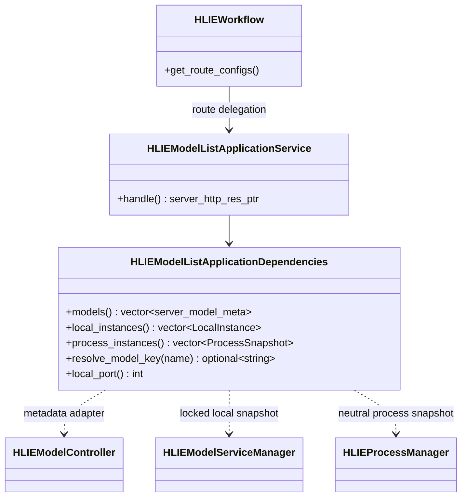
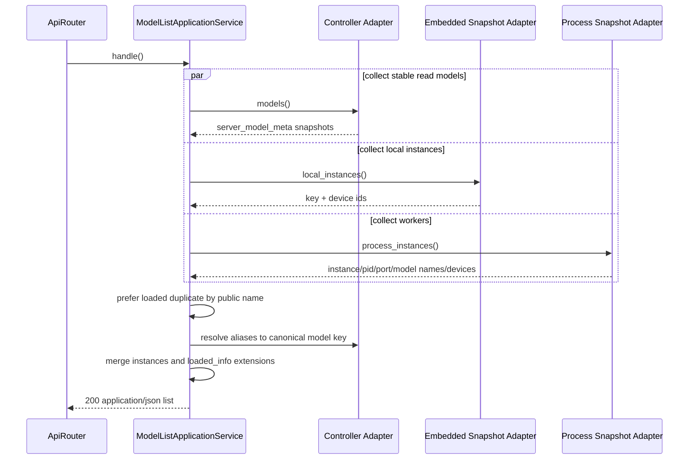

# P1-7 Model List Application Service

`HLIEModelListApplicationService` owns the OpenAI-compatible `/v1/models`
response view. It merges the legacy controller metadata projection with local
embedded-Service and Worker-process snapshots, while preserving existing
HLIE extensions such as status, instances, device ids, capabilities, roles,
and llama parameter summaries.

This service is an app-layer compatibility view, not the core model catalog.
`IHLIEModelCatalog`/`HLIEModelCatalog` remain transport-neutral model identity
and specification owners; JSON and `server_model_meta` stay in `hlie-app`.

## Class Boundary

The application service has no direct Controller, ServiceManager,
ProcessManager, concrete model Service, DeviceService, Singleton, TCIM, or
GGML dependency. Production adapters are assembled by
`HLIEApplicationCompositionRoot`; transport/OS objects never cross the
snapshot contract.

## Request Sequence

The implementation currently invokes providers sequentially; the `par`
notation describes independent read ownership, not concurrent execution.

## Compatibility Rules

- Models remain de-duplicated by public `meta.name`, preferring a loaded record.
- Local instance id/process id remain `0`; its port remains the current server
  port and empty Service device ids fall back to `loaded_info.device_ids`.
- Worker ports remain `local_port + instance_id`; aliases are resolved through
  Controller snapshots before matching the public model.
- `model_type`, `service_kind`, `role`, `model_family`, `architecture`,
  `multimodal`, `capabilities`, `llama_presets`, `llama_params_hash`, and
  `llama_params_summary` retain their previous output conditions.
- Listing remains read-only and performs no model file, GGUF, preset, or SDK IO.

No per-request route log is emitted: a normal model listing is high-frequency
read traffic and does not represent a lifecycle transition. Failures in
snapshot providers remain owned and logged by their adapters.

The architecture gate prevents orchestration from returning to Workflow and
prevents the service from acquiring concrete control/runtime dependencies.
Focused tests cover loaded-record preference, local and Worker instance
mapping, alias resolution, extension fields, and device metadata fallback in
both full and SDK-free targets. The focused slice passes 2 cases and 16
assertions in each target; Windows Release server/unit builds pass, full
Release CTest is 24/24, and `HLIE_TESTS_ONLY` CTest is 22/22.
