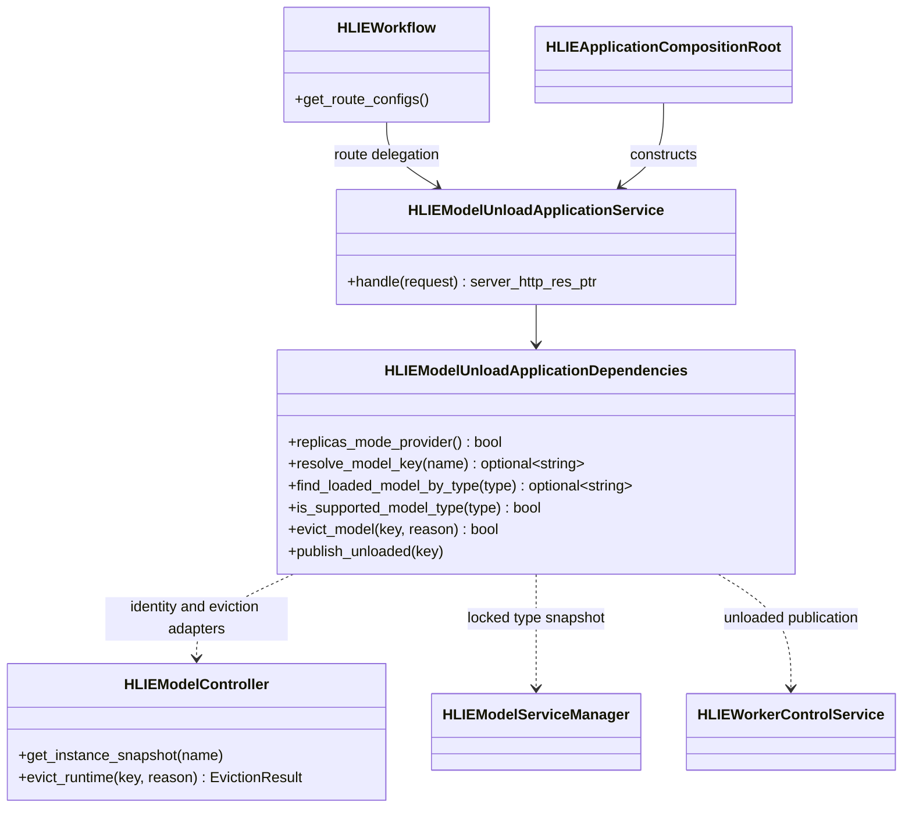
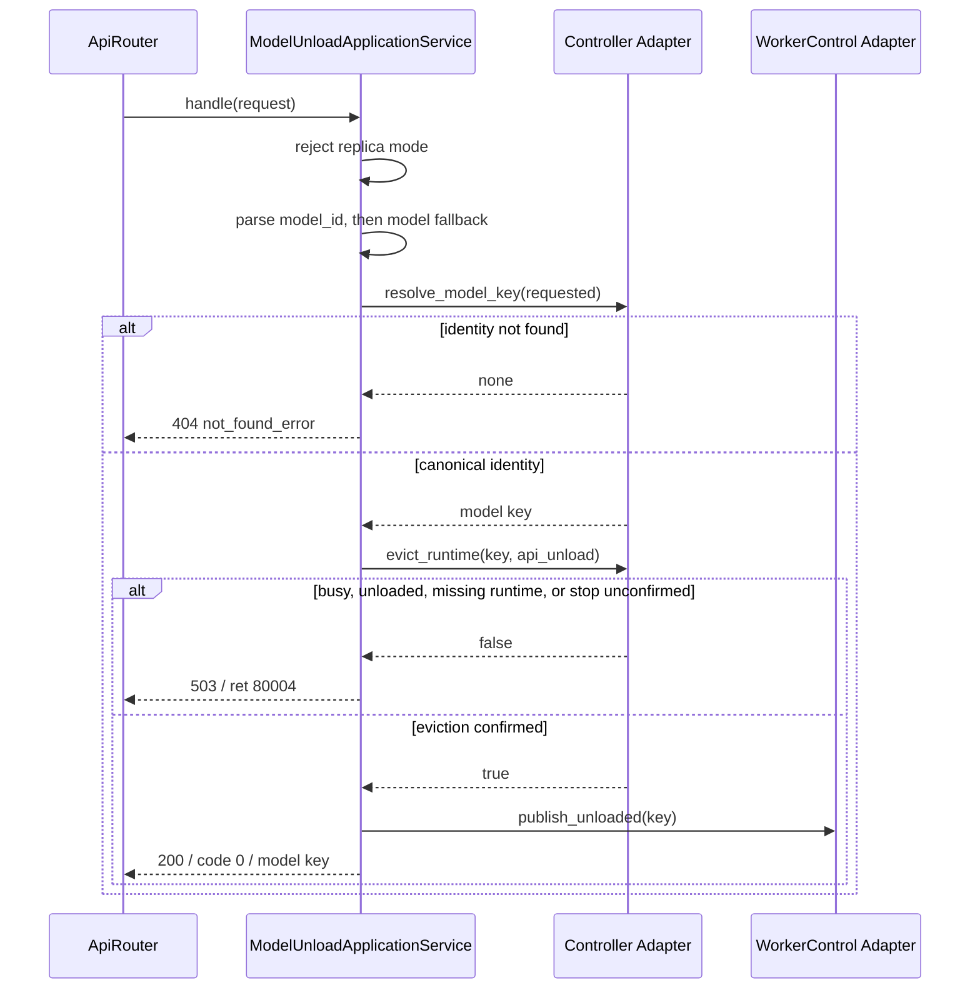
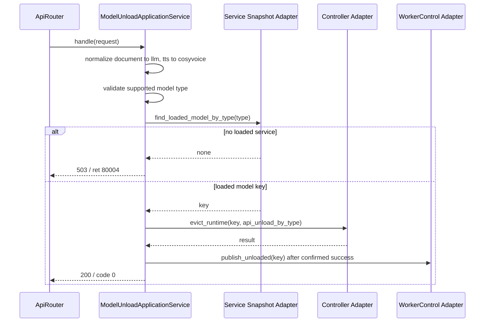

# P1-7 Model Unload Application Service

`HLIEModelUnloadApplicationService` owns the compatibility boundary for
`POST /hlie/v1/unload_model` and `POST /models/unload`. It parses the legacy
selectors, maps validation and lifecycle outcomes to HTTP/JSON, and delegates
the actual eviction transaction through composition-provided ports.

This extraction does not create another lifecycle owner. `HLIEModelController`
remains the only owner of eviction claims, generation fencing, runtime stop and
detach, reservation release, and Registry state publication.

## Class Boundary

The application service does not include or store Controller, Registry,
ServiceManager, ProcessManager, DeviceService, concrete model Service, TCIM, or
GGML types. Those objects remain behind adapters assembled by
`HLIEApplicationCompositionRoot`.

## Request Sequences

Explicit identity is authoritative when either `model_id` or its legacy
fallback `model` is present:

When identity is absent, the service preserves the legacy type selector:

## Compatibility Matrix

| Input or condition | Resolution | HTTP result |
| --- | --- | --- |
| `model_id` present | Resolve that identity; ignore `model` and `model_type` | `200` with canonical `model`, or `404` |
| `model` present without `model_id` | Legacy identity fallback | Same as `model_id` |
| Neither identity nor type | Default to `llm` | Type-selected unload |
| `model_type=document` | Use the owning LLM lifecycle | Type-selected unload |
| `model_type=tts` | Preserve legacy CosyVoice selection | Type-selected unload |
| Unsupported type | No lifecycle call | `400`, ret `80006` |
| Replica mode | No lookup or lifecycle call | `501`, ret `80005` |
| Busy, unloaded, runtime missing, or unconfirmed stop | Controller refuses eviction | `503`, ret `80004` |

JSON parsing and non-string identity coercion retain the prior behavior. Worker
`UNLOADED` publication happens only after Controller confirms eviction.

## Ownership And Logging

- The facade never marks Registry state or releases Scheduler reservations.
- It never directly stops an embedded Service or Worker process.
- `document` remains a companion of the LLM runtime, not an independently
  unloadable runtime.
- HTTP success mapping is `DEBUG`; Controller records the authoritative
  lifecycle transition at `INFO`.
- Busy or unmatched eviction and a supported type with no loaded Service are
  recoverable `WARN` events.
- Prompt, response body, transcript, and launch token are never logged.

The architecture gate rejects direct runtime/control dependencies and rejects
return of `handle_unload_model` or `api_unload_by_type` orchestration to
Workflow. Focused tests cover explicit identity precedence, legacy `model`
fallback, replica rejection, not-found and busy outcomes, `document`/`tts`
aliases, default LLM selection, invalid types, absent loaded Services, and
Worker unloaded publication. Both full Release and SDK-free slices pass 4 test
cases and 57 assertions; Windows Release CTest passes 26/26 and SDK-free CTest
passes 24/24.
