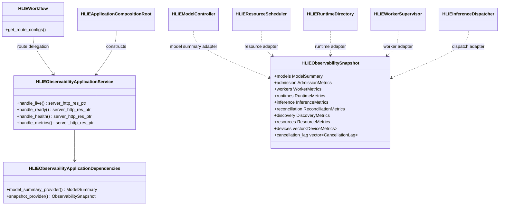
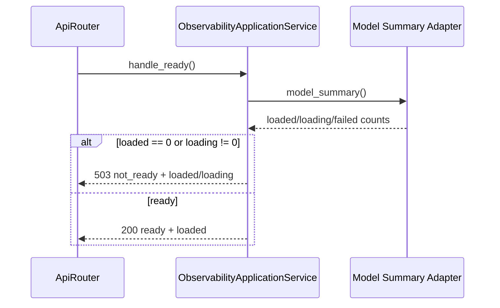

# P1-7 Observability Application Service

`HLIEObservabilityApplicationService` owns the public read-only observability
surface:

- `GET /live` and `GET /livez`
- `GET /ready` and `GET /readyz`
- `GET /health` and `GET /v1/health`
- `GET /metrics` and `GET /hlie/v1/metrics`

It renders health/readiness JSON and Prometheus text from a neutral immutable
snapshot. It does not query Controller, Scheduler, RuntimeDirectory,
Supervisor, Dispatcher, Reconciler, Discovery, AdmissionController, or
cancellation globals directly.

## Class Boundary



The DTO structs contain only scalars, strings, and vectors. They do not expose
runtime handles, launch tickets, concrete Services, HTTP requests, or SDK
types. Composition owns the translation from live owner-specific metrics into
this snapshot.

## Read Sequences

`/ready` deliberately uses a small provider and does not collect all metrics:



`/health` and `/metrics` share the same full snapshot contract:

```mermaid
sequenceDiagram
    participant R as ApiRouter
    participant O as ObservabilityApplicationService
    participant C as Composition Snapshot Adapter
    participant Owners as Controller/Scheduler/Runtime/Supervisor/Dispatcher

    R->>O: handle_health() or handle_metrics()
    O->>C: snapshot()
    C->>Owners: immutable metrics and health snapshots
    Owners-->>C: owner-specific values
    C-->>O: neutral ObservabilitySnapshot
    alt health
        O-->>R: 200 application/json
    else metrics
        O-->>R: 200 text/plain; version=0.0.4
    end
```

`/live` is a fixed process-liveness response and does not invoke either
provider.

## Compatibility Contract

- Readiness remains `503` when there are no loaded models or any model is
  loading. A ready response keeps only `status` and `loaded_models`.
- Health remains `degraded` only when a model is Failed or a runtime is Failed
  or Orphaned. `ready` remains based on at least one ready model.
- Existing JSON groups and field names remain unchanged: `models`,
  `admission`, `workers`, `runtimes`, `inference_dispatch`,
  `control_plane_reconciliation`, `model_discovery`, `resources`,
  `backend_cancellation_lag`, and `devices`.
- Existing Prometheus metric names, labels, line order, and trailing newline
  remain unchanged.
- Device health continues to omit observed-available and exclusivity fields;
  adding public metrics is a separate compatibility decision.

The snapshot is collected sequentially, as before. It is a coherent
per-owner observation rather than a global transactional snapshot; monitoring
consumers must tolerate values changing between scrapes.

## Logging And Verification

These high-frequency read endpoints emit no request logs at INFO or DEBUG.
Owner-side failures and state changes remain logged where they occur. No model
payload, prompt, transcript, response body, launch token, or process parameter
enters the observability snapshot.

The architecture gate prevents direct control/runtime dependencies and keeps
all four renderers out of Workflow. Focused full and SDK-free tests pass 4
cases and 43 assertions. They cover the complete health JSON contract,
lightweight live/readiness behavior, healthy/degraded derivation, and an exact
Prometheus golden string. Windows Release CTest passes 28/28 and SDK-free CTest
passes 26/26.
