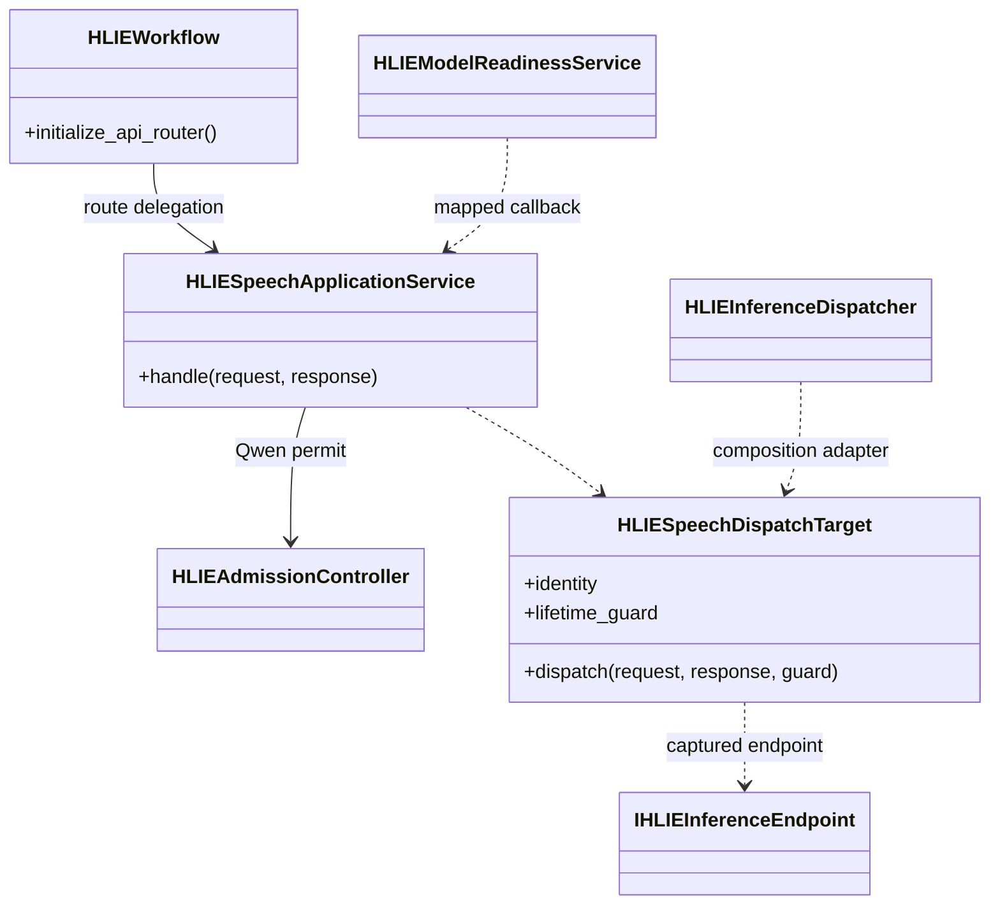
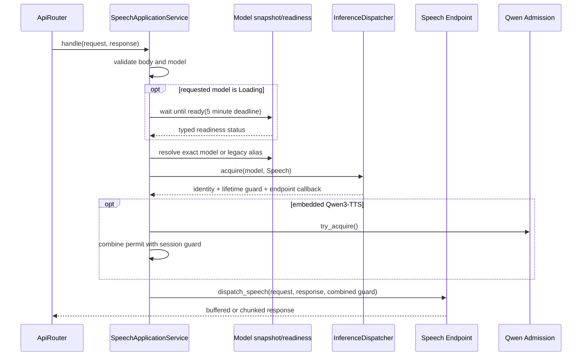

# P1-7 Speech Application Service

`HLIESpeechApplicationService` owns the OpenAI-compatible speech request
boundary for CosyVoice and Qwen3-TTS. It preserves the existing embedded and
Worker behavior while removing speech model selection, loading wait,
generation session acquisition, admission lifetime, and endpoint invocation
from `HLIEWorkflow`.

## Ownership

The service owns:

- JSON/model validation and legacy model aliases;
- model-less CosyVoice compatibility behavior;
- explicit-model loading wait and readiness error mapping;
- CosyVoice/Qwen3-TTS selection;
- Qwen3-TTS embedded admission;
- `X-HLIE-TTS-Backend` response selection;
- endpoint dispatch, native-dispatch observation, and HTTP error mapping.

It does not own Registry/Controller state, Runtime publication, concrete TTS
services, Worker proxy construction, or the inference session itself. The
composition root adapts `HLIEInferenceDispatcher::acquire()` into a
generation-bound `HLIESpeechDispatchTarget` containing only neutral identity,
a lifetime guard, and a dispatch callback.

## Request Sequence

The combined guard preserves the P1-6 destruction rule for streaming Qwen and
Worker responses: upstream response/proxy state is released before the model
request lease and admission permit become reusable.

## Compatibility

- A missing `model` continues to prefer a ready embedded CosyVoice model.
- If only Qwen3-TTS is ready, `model` remains required.
- `cosyvoice`, `tts`, `qwen3_tts`, and `qwen3-tts` aliases retain their prior
  behavior.
- Only explicitly requested models already in `Loading` state wait for
  readiness; unloaded speech models are not auto-loaded by this endpoint.
- The existing five-minute wait deadline and client disconnect cancellation
  remain unchanged.

## Logging And Verification

Successful per-request speech selection is logged at `DEBUG`, not `INFO`.
Endpoint exceptions are `ERROR` and include model/generation without request
body or synthesized content. Admission rejection and typed HTTP failures are
returned to the caller without repetitive lifecycle logging.

The architecture gate
`hlie.architecture.speech-application-service-dependencies` prevents the
service from depending on Workflow, Controller, ModelReadinessService,
Dispatcher implementation, ServiceManager, concrete model services,
ProcessManager, DeviceService, Singleton, TCIM/GGML, or llama server response
helpers. It also prevents speech operation/session ownership from returning to
Workflow.

Focused tests cover validation, model-less CosyVoice, Qwen model requirements,
loading-to-ready selection, embedded admission lifetime, response backend
headers, and dispatch observation in both normal and SDK-free test targets.
The focused slice passes 4 cases and 17 assertions in both targets. Windows
Release builds pass for the server and unit-test targets; full Release CTest is
22/22 and `HLIE_TESTS_ONLY` CTest is 20/20.
