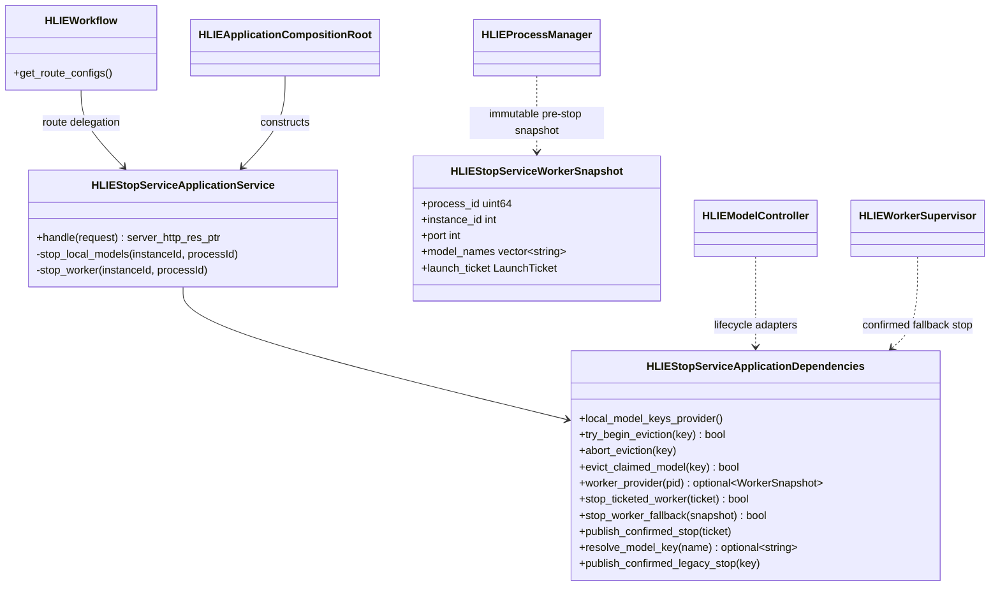
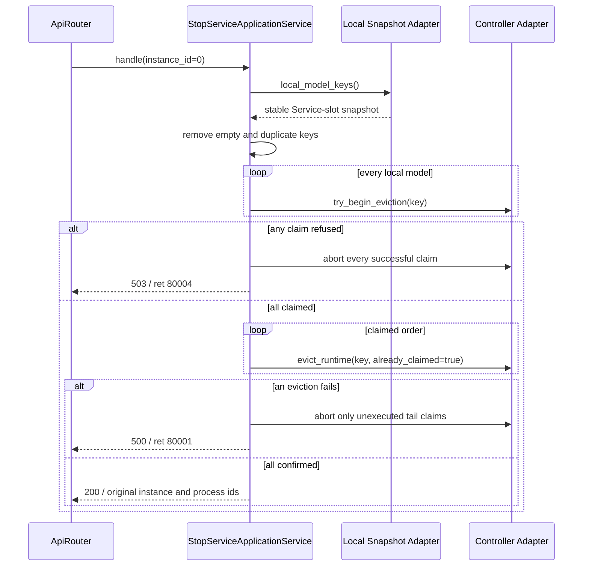
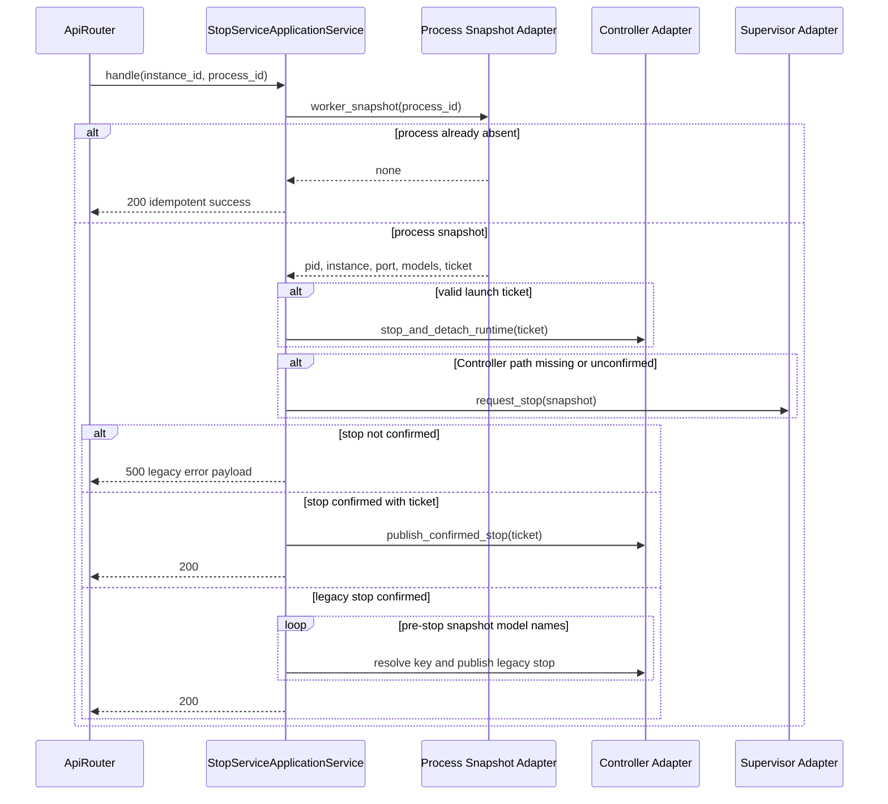

# P1-7 Stop Service Application Service

`HLIEStopServiceApplicationService` owns the compatibility behavior of
`POST /hlie/v1/stop`. The endpoint has two distinct commands:

- `instance_id == 0`: atomically claim all currently embedded model runtimes,
  then evict them as a batch.
- `instance_id != 0 && process_id != 0`: stop a dynamic Worker and reconcile
  its generation or legacy model identities after confirmed process exit.

The service coordinates these operations through narrow ports. It does not
own Registry state, Scheduler reservations, embedded Service slots, process
handles, or Worker supervision.

## Class Boundary

The application service has no direct Controller, Registry, ServiceManager,
ProcessManager, WorkerSupervisor, concrete model Service, TCIM, or GGML
dependency. Workflow only adapts a process record into an immutable snapshot;
composition supplies Controller and Supervisor operations.

## Local Batch Sequence

The claim phase remains all-or-nothing before execution. Once an eviction has
been confirmed it cannot be rolled back; a later failure returns `500` and
leaves already confirmed models unloaded. Crucially, the failed current model
is not passed to `abort_eviction`: Controller may have marked an unconfirmed
runtime orphaned and must retain ownership conservatively.

## Worker Sequence

Legacy reconciliation deliberately consumes `model_names` captured before
stopping the process. Querying ProcessManager after confirmed exit can return
an empty record set and previously left Registry/Scheduler ownership live.

## Compatibility And Corrections

| Condition | Result |
| --- | --- |
| Replica mode | `501`, ret `80005`, before JSON parsing |
| Local models all idle | `200`, all models evicted |
| Any local model busy/unloaded | `503`, ret `80004`, all acquired claims aborted |
| Local eviction fails after claim | `500`, ret `80001`, only unexecuted tail claims aborted |
| Ticketed Worker | Controller-owned stop first; Supervisor is compatibility fallback |
| Legacy Worker | Supervisor stop, then pre-stop model snapshot reconciliation |
| Process already absent | Idempotent `200` |
| Nonzero instance with zero process | Compatibility no-op `200` |
| Worker stop unconfirmed | Existing array-shaped `500` error body is preserved |

The two ownership corrections are intentional internal fixes without changing
the endpoint's success/error status contract:

1. Legacy Worker model identities are retained across process-record cleanup.
2. A failed current eviction is not made evictable again by the facade.

## Logging And Verification

- Successful HTTP mapping and idempotent/no-op requests are `DEBUG`.
- Busy local batches are recoverable `WARN` events.
- Unconfirmed local or Worker stops are `ERROR`; the runtime owner retains the
  detailed lifecycle failure.
- Launch tokens, process parameters, prompts, transcripts, and response bodies
  are never logged.

The architecture gate prevents concrete lifecycle/process dependencies and
prevents `stop_service`, `api_stop_service`, or post-stop
`get_working_models(instance_id)` orchestration from returning to Workflow.
Focused full and SDK-free tests pass 6 cases and 52 assertions, covering batch
success, duplicate keys, busy rollback, failed-eviction tail rollback,
ticketed stop, Supervisor fallback, legacy reconciliation, unconfirmed stop,
idempotency, compatibility no-op, and replica rejection. Windows Release CTest
passes 27/27 and SDK-free CTest passes 25/25.
