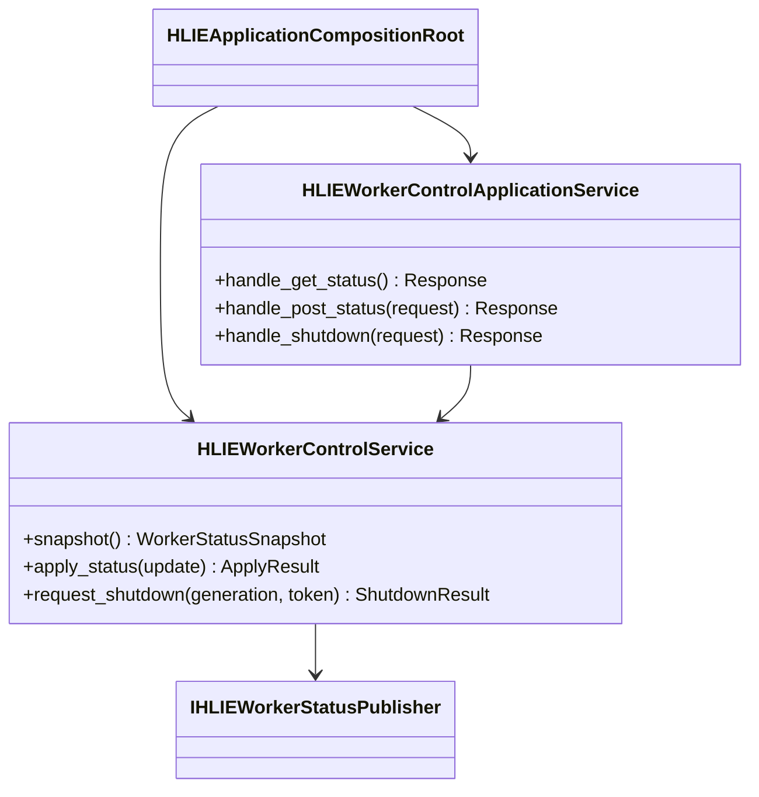
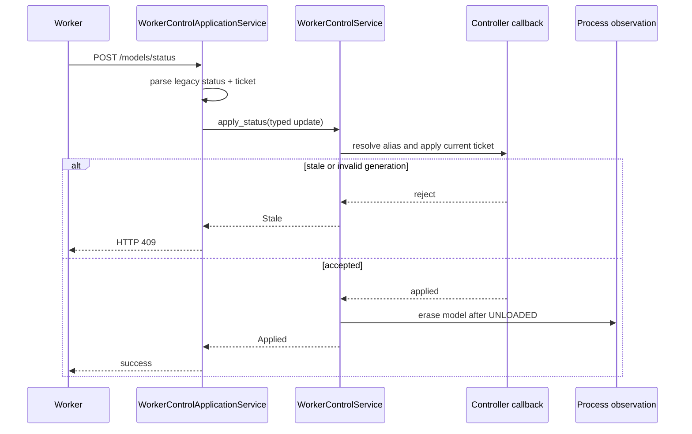
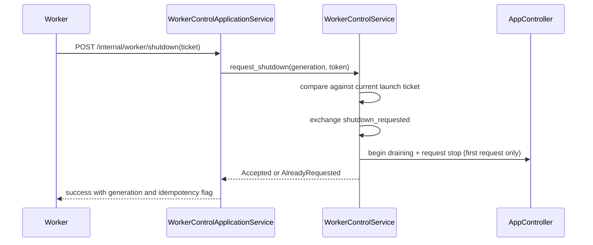

# P1-7 Worker Control Service

Status: transport-neutral control and HTTP application façade implemented.

## Responsibility

`HLIEWorkerControlService` owns the compatibility protocol around dynamic
Workers:

- delayed READY publication and task lifetime;
- synchronous LOADED/UNLOADED publication for local model lifecycle events;
- model alias resolution and launch-ticket/generation fencing for
  `/models/status` updates;
- process-model cleanup after an accepted UNLOADED update;
- typed processor snapshots used by the legacy status DTO;
- shutdown ticket validation, draining transition, and callback idempotency.

The service does not parse HTTP or JSON, access `HLIEProcessManager`, call a
concrete model Service, or know the HOUMO transport. It receives observations
and lifecycle operations through callbacks supplied by the composition root.

`HLIEWorkerControlApplicationService` is the separate compatibility layer
above it. The application service owns GET status DTO assembly, POST status
JSON/status conversion, shutdown JSON/error mapping, and HTTP-facing log
levels. It directly depends only on the typed WorkerControlService and a launch
ticket provider; launch tokens are used for fencing and never logged.

## Dependency Direction

```text
ApiRouter -> WorkerControlApplicationService -> WorkerControlService
                    |                         |
                    v                         v
          JSON/status mapping       Controller + process observations

HLIEWorkerControlService -> IHLIEWorkerStatusPublisher
                                  ^
                                  |
                 HLIEHttpWorkerStatusPublisher (app adapter)
```

`IHLIEWorkerStatusPublisher` carries a typed publication containing router
port, model key, status, local port, and optional launch ticket. The HTTP
implementation is the only place that serializes `/models/status` JSON and
performs the loopback request.



## Status Update Sequence



The Controller callback remains the lifecycle authority. The service only
coordinates protocol fencing and does not duplicate Registry state.

## Shutdown Sequence



Invalid tickets and non-dynamic/replica instances retain the existing 80009
compatibility response. A missing process-stop callback retains the 80001
server error.

Normal request receipt is `DEBUG`. An applied status transition and first
graceful shutdown are lifecycle `INFO`; lookup failure and invalid shutdown
ticket are `WARN`; stale status fencing is `DEBUG`. No request body or launch
token is logged. The legacy LookupFailed status acknowledgement remains HTTP
success for compatibility even though the mismatch is recorded at `WARN`.

## Lifecycle Ordering

`HLIEWorkflow::stop()` first stops asynchronous READY tasks, then stops runtime
handles and Workers, then publishes synchronous UNLOADED notifications while
the original Worker launch ticket is still available. The WorkerControlService
and its publisher are ordered so the service is destroyed first; callbacks can
never outlive their transport adapter.

## Verification

- `hlie.architecture.worker-control-service-dependencies` rejects HTTP,
  Workflow, ProcessManager, concrete Service, Singleton, TCIM, and GGML
  dependencies in the service.
- `hlie.architecture.worker-control-application-service-dependencies` keeps the
  HTTP application layer independent of Workflow, Controller, ProcessManager,
  ServiceManager, concrete Services, Singleton, TCIM, and GGML.
- Unit coverage verifies typed publication, alias/generation fencing,
  UNLOADED cleanup, shutdown idempotency, and neutral processor snapshots.
- Application coverage verifies the processor JSON shape, applied/lookup/
  stale status mapping, shutdown ticket errors, and idempotent success shape in
  both full and SDK-free targets.
- Windows Release CTest and `HLIE_TESTS_ONLY=ON` CTest both include the new
  architecture gate and service tests.
