# HLIECpp P1 Workflow 架构重构详细设计

- 状态：Accepted，P1-0 实施中
- 更新时间：2026-08-18
- 适用范围：`hlie-base`、`hlie-core`、`hlie-app` 三层边界，API 路由、模型生命周期、资源调度、运行时承载、Worker 监督、模型发现和控制面可观测性

## 1. 执行摘要

P0 已经建立 generation fence、事务式设备 reservation、request lease、Worker 故障收敛、准入保护、日志/指标和跨平台测试护栏。P1 不重写 decode loop，也不改变 TCIM、llama、Whisper、Stable Diffusion 等后端的核心执行逻辑；P1 的目标是把这些已验证的不变量从 `HLIEWorkflow` 的过程式编排中提升为明确的模块边界和类型契约。

当前 `src/hlie_app/hlie_workflow.cpp` 为 5435 行、66 个成员方法，包含 49 处 Singleton 访问。它同时承担：

- HTTP/API 解析与路由；
- 模型发现、preset 解析和启动参数拼装；
- 本地 Service 创建、启动、停止和类型分支；
- 动态 Worker 创建、READY、代理、退出和强杀；
- Registry 状态迁移、generation 校验和 request lease；
- 设备 reservation 绑定、提交、回滚和 orphan reconciliation；
- LRU/TTL 驱逐；
- admission、health、metrics、日志和多个后台线程。

P1 的核心决策是：

1. `HLIEModelController` 成为模型生命周期和运行实体发布的唯一写入口。
2. `HLIEModelRegistry` 继续作为模型实例事实来源，但由 Controller 私有拥有；Router、Scheduler、Supervisor 不直接修改它。
3. 本地模型和子进程模型统一为 `IHLIEModelRuntime`，分别由 `HLIEEmbeddedWorkerTransport` 和 `HLIEProcessWorkerTransport` 承载；本地调用不增加 HTTP hop。
4. `HLIEResourceScheduler` 只做 placement、reservation 和 eviction plan，不直接停止模型。
5. `HLIEWorkerSupervisor` 只拥有进程、端口、manifest 和 OS 退出确认，通过 generation-fenced 事件通知 Controller，不直接改 Registry 或释放 reservation。
6. `HLIEBackendRegistry` 通过显式注册的 descriptor/adapter 集中模型分类、能力、内存估算和 embedded runtime 创建；业务代码不再散落模型类型 switch。
7. `HLIEApiRouter` 只处理协议，`HLIEInferenceDispatcher` 只处理 runtime lease 和调用分发；二者都不持有具体模型 Service 指针。
8. `HLIEWorkflow` 在迁移期保留为兼容 façade，最终只负责模块组装、启动、drain 和停止。
9. 新建生产级 `hlie-core`，承载不依赖 HTTP、进程管理和具体模型 Service 的框架不变量；测试不再建立另一个冒充 core 的实现，未解污染源码只能暂留明确命名的 test support。
10. P1 只面向当前唯一的 HOUMO TCIM SDK，不建立多 SDK、多代 NPU provider/compatibility 体系；TCIM 具体实现集中在 `hlie-app` 或 `hlie-base` 现有兼容区，不进入 core public contract。

P1 是否成功，不以“拆出多少文件”为判断，而以状态所有权是否唯一、依赖是否单向、事务是否可回滚、故障是否能收敛、模块是否可独立测试为判断。

## 2. P1 目标与非目标

### 2.1 目标

- 消除 Workflow 中本地 Service 与动态 Worker 的两套生命周期分支。
- 让加载、READY、卸载、驱逐、崩溃和 shutdown 使用同一个状态机和事务模型。
- 将模型实例状态、runtime handle、reservation 绑定和 request lease 在一个 generation 下发布和校验。
- 让 API 层不依赖 `LLModelService`、`WhisperModelService` 等具体类型。
- 让新增 backend 的正常改动集中在 descriptor/adapter 和 backend 自身，不扩散到 Workflow、Factory、Manager、路由和状态逻辑。
- 建立三个生产级物理层：`hlie-base`、`hlie-core`、`hlie-app`；app 可以同时直接依赖 core 和 base。
- 以 `hlie-core` 的状态所有权、公共类型和禁止依赖形成稳定的“框架宪法”。
- 让控制面核心可以在不链接专有 SDK/HAL/推理库的测试目标中运行。
- 保持现有 OpenAI-compatible API、HLIE 扩展 API、Worker ticket 鉴权和配置键兼容。
- 为后续优先级、公平调度、租户配额、完整 tracing 和多副本策略提供稳定扩展点。

### 2.2 非目标

- 不重写 llama/Houmo decode loop、continuous batching 或 KV cache。
- 不在 P1 强行实现 TCIM 当前不支持的 CosyVoice/SD backend 硬取消。
- 不把 embedded runtime 改成 localhost HTTP 调用。
- 不在 P1 建立独立的 `hlie-platform`、`hlie-device-*`、`hlie-backend-*` 物理库；这些名称最多作为 app 内部目录/namespace 使用。
- 不在 P1 实现多 SDK、多代 NPU CompatibilityResolver、动态库式 backend 插件 ABI 或跨进程 SDK 隔离。
- 不同时重写所有模型 Service 的内部队列和推理实现。
- 不引入跨节点分布式一致性、外部数据库或通用工作流引擎。
- 不借架构重构改变现有 API 响应结构、错误码或默认路由行为。

## 3. 现状问题与根因

### 3.1 God Object 不是行数问题，而是所有权问题

Workflow 目前直接持有或访问 `HLIEModelServiceManager`、`HLIEModelRegistry`、`HLIEDeviceService`、`HLIEProcessManager`、`model_reservations_`、多个 admission controller 和三个后台线程族。加载、卸载和故障路径需要人工维持这些对象之间的一致性。

单纯把 5435 行按函数复制到多个 `.cpp`，仍会保留共享 `this`、共享锁和跨模块状态修改，得到的只是多个小型 God Object。

### 3.2 运行状态存在多处投影

同一模型是否真正可用，目前需要综合判断：

- Registry 的 status、port、generation 和 active_requests；
- ServiceManager 中是否存在具体 Service 指针；
- ProcessManager 中是否存在对应 PID；
- `model_reservations_` 是否绑定当前 ticket；
- DeviceLedger 的 reservation 是否 committed；
- Worker 是否已经 READY 或已经退出。

P0 已经通过 ticket 和 fail-closed 规则降低风险，但这些投影仍由 Workflow 手工协调。P1 需要把“READY 意味着什么”固化到单一发布操作中。

### 3.3 本地模型与动态 Worker 双轨

本地模型通过 typed Service slot 直接调用，动态 Worker 通过 ProcessManager、端口和 HTTP proxy 调用。两条路径在加载、READY、停止、失败和资源释放上的实现不同，导致任何生命周期增强都必须修改两遍。

双轨应该收敛在 runtime transport 层，而不是暴露到 Controller 和 Router。

### 3.4 模型类型知识扩散

模型分类同时存在于 Factory、ServiceManager、Workflow 初始化、动态加载、卸载、路由和状态更新中。新增 backend 容易出现“能扫描但不能启动”“能启动但不能卸载”“本地可用但 Worker 不可用”等半接入状态。

### 3.5 协议层与执行层耦合

Workflow route handler 直接调用具体 Service 的 HTTP handler。API 解析、模型选择、自动加载、runtime lease、admission、backend 调用和响应生命周期交织，难以单测，也容易破坏“响应先销毁、lease 后释放”的顺序。

### 3.6 Singleton 和后台线程降低可测试性

Workflow 内大量 Singleton 获取隐藏了真实依赖；WorkerSupervisor、model discovery、TTL eviction 的线程和状态也由 Workflow 直接维护。组件无法通过 fake port 独立测试，只能依赖大对象或真进程。

### 3.7 hlie-base 当前不是纯基础库

当前 `hlie-base` 的 CMake target 直接链接 TCIM、Kaldi 和 GGML，并包含 `hlie_tcim_util`、TCIM sampler、GGUF-to-TCIM bundle、Kaldi audio、NPU performance 环境调优及 TCIM logger adapter。因此 P1 新建的 `hlie-core` 即使代码层不调用 SDK，也会通过 base 保留现有传递链接依赖。

在“当前只有 HOUMO TCIM SDK”的产品约束下，P1 接受这个客观现状，不把彻底净化 base 作为 Workflow 重构的前置条件。P1 的强制边界是：core public header 和领域语义不得出现 TCIM/HAL/GGML/Kaldi 类型，base 不再新增生命周期、Registry、reservation 等控制面职责。将 SDK adapter 从 base 物理迁出作为 Future/P2 治理项。

## 4. 设计原则和强制规则

### 4.1 单一写入口

- 模型生命周期状态只能由 `HLIEModelController` 迁移。
- Router、Supervisor、Scheduler、Discovery 只能提交 command/event/plan，不能直接写 Registry。
- Registry 不向外返回可变引用；现有 compatibility mutable lookup 在 P1 结束前删除。

### 4.2 generation-fenced、幂等事件

- 所有 READY、FAILED、EXITED、STOPPED 事件必须携带完整 `HLIEModelLaunchTicket`。
- Controller 对 stale ticket 返回 `IgnoredStale`，不能影响新 generation 的 runtime、reservation 或 request count。
- 同一事件重复到达必须幂等。

### 4.3 阻塞调用不持锁

- backend `init/run/stop`、HTTP proxy、进程 wait/terminate、文件 IO、HAL 查询和用户 callback 都不得在 Registry、Scheduler、Supervisor 内部锁下执行。
- 组件 API 只返回 snapshot、ticket、lease 或明确所有权对象，不返回受内部锁保护的引用。
- Supervisor 发事件前必须释放自己的 process table 锁。

### 4.4 资源释放以事实为准

- pending reservation 可以由事务 guard 自动 rollback。
- committed reservation 只能在 runtime stop/exit 已确认后 release。
- embedded backend stop 卡死或进程退出无法确认时进入 `ORPHANED`，关闭路由但保留 reservation；不得用 TTL 猜测硬件已经释放。

### 4.5 协议与领域隔离

- `HLIEModelController`、`HLIEResourceScheduler` 和 `HLIEWorkerSupervisor` 的 public header 不出现 `httplib`、`server_http_req` 或 `server_http_res_ptr`。
- HTTP JSON、错误码和兼容别名只存在于 API adapter。
- 领域错误使用 typed result，由 API 层映射为 HTTP 状态和既有错误体。

### 4.6 显式依赖注入

- 新增控制面类通过构造函数注入依赖，不在内部调用 `Singleton<T>::instance()`。
- Singleton 兼容只允许留在 composition root，迁移结束后再决定是否彻底移除。

### 4.7 显式注册，不依赖静态初始化顺序

- built-in backend 在应用启动时按确定顺序注册。
- 不使用跨动态库静态注册宏，不把注册成功依赖于链接器是否保留某个 translation unit。

### 4.8 core 按依赖语义准入，不按改动频率准入

- `hlie-core` 承载当前所有模型 backend 都必须遵守的领域规则和应用契约。
- “很少修改”不是进入 core 的充分条件；gzip、文件扫描即使稳定，也不是推理框架核心。
- “仍在演进”也不是拒绝进入 core 的理由；ModelController 会在 P1 频繁调整，但它拥有框架核心生命周期语义。
- core public header 禁止出现 TCIM/HAL/llama/Kaldi、`httplib`、`server_model_meta`、Win32/POSIX handle 和具体 Service 类型。
- core 不读取全局环境变量、不访问 Singleton；配置由上层解析为 immutable options 后注入。

## 5. 目标分层和依赖方向

### 5.1 三层物理依赖：框架宪法

图中箭头表示“上层依赖下层”：

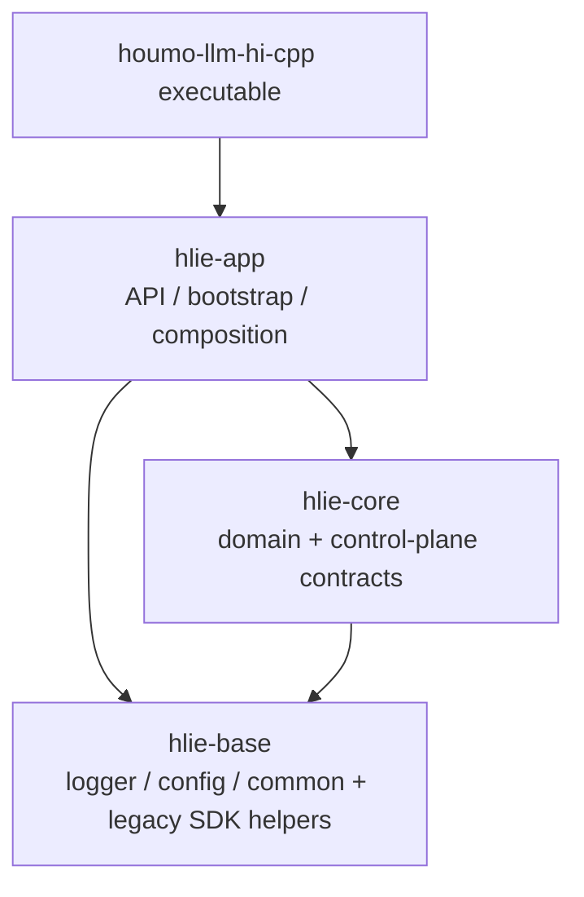

硬性规则：

- P1 只建立 `hlie-base`、`hlie-core`、`hlie-app` 三个主要生产 target，不为逻辑目录机械创建库。
- `hlie-app` 可以直接使用 base 的 logger、config、通用工具和现有 TCIM helper；不要求所有基础调用经 core 转发。
- `hlie-app` 同时依赖 core 和 base，`hlie-core` 依赖 base；base 不反向依赖 core/app，core 不反向依赖 app。
- `hlie-app` 是功能实现与 composition layer，HTTP、进程、模型发现、TCIM Service、embedded/process transport 都可以作为其内部模块。
- app 直连 base 不能绕过 core 的控制面所有权：生命周期、Registry、generation、request lease 和 reservation 状态仍必须经过 core owner。
- 现有 base 的专有 SDK 传递依赖在 P1 可保留，但 core public contract 禁止暴露 SDK 类型，新控制面代码禁止继续进入 base。

`hlie-core` 准入矩阵：

| 内容 | 是否进入 core | 原因 |
| --- | --- | --- |
| lifecycle、generation、ticket、typed error | 是 | 跨协议/硬件不变量 |
| Registry、runtime lease、operation coalescing | 是 | 运行状态事实和并发语义 |
| DeviceReservationLedger、ResourceScheduler policy | 是 | 纯资源规则；HAL observation 以中性 snapshot 输入 |
| BackendDescriptor、Capability、BackendRegistry | 是 | backend 扩展契约，不含具体 SDK |
| lifecycle、ticket、ModelSpec、catalog 只读 port、residency policy | 是 | 跨 app adapter 的稳定规则和契约 |
| ModelController、DiscoveryService、Reconciler timer | 否 | app 应用编排与线程生命周期，不进入 core |
| HTTP DTO、WebService、error body | 否 | API adapter |
| ProcessManager、port probe、manifest IO | 否 | app 内的进程实现 |
| TCIM tensor、HAL handle、driver API | 否 | app/base 现有 SDK 实现 |
| GGUF 文件解析、模型目录扫描 | 否 | app discovery 或 base 现有 helper |
| 具体 LLM/Whisper/CosyVoice/SD Service | 否 | app 内的 backend 实现 |

### 5.2 目标组件关系

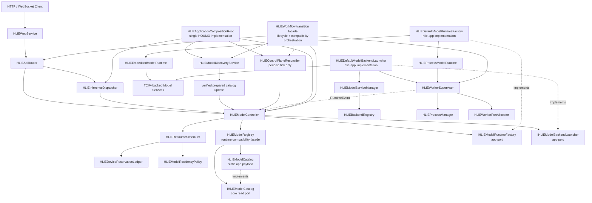

### 5.3 组件依赖规则

依赖必须自上而下：

| 层 | 可以依赖 | 禁止依赖 |
| --- | --- | --- |
| API | application contracts、DTO、auth policy | 具体 Service、DeviceLedger、ProcessManager |
| Application/Controller | domain types、Registry、Scheduler port、Runtime port | HTTP 类型、具体 TCIM/llama backend |
| Domain | 标准库、强类型标识、纯状态规则 | Singleton、线程、HTTP、HAL、文件系统 |
| hlie-app runtime/process | runtime port、BackendRegistry、ProcessManager、base helpers | Registry 写入口、Scheduler 内部状态 |
| hlie-app backend | TCIM Service、runtime command/reply、base helpers | Registry、Scheduler、API 路由表 |
| Bootstrap/Workflow | 所有模块的构造接口 | 具体业务状态迁移 |

### 5.4 现有职责迁移矩阵

| 当前 Workflow 内容 | P1 owner | 迁移后的交互方式 |
| --- | --- | --- |
| `RouteConfig`、HTTP handlers、兼容路径 | ApiRouter | command/result + error mapper |
| typed Service handler 调用 | InferenceDispatcher + BackendAdapter | RuntimeLease + capability dispatch |
| Registry 状态迁移和 generation | ModelController | lifecycle command/event |
| `model_reservations_` 与 ledger bind/commit/release | ResourceScheduler | typed pending/committed handle |
| LRU、TTL、loaded-limit 候选选择 | ResourceScheduler | eviction plan，由 Controller 执行 |
| supervisor thread、READY probe、exit drain | WorkerSupervisor | RuntimeEventSink |
| ProcessManager、port、manifest | WorkerSupervisor | process runtime identity |
| ServiceManager/ServiceSlot | EmbeddedModelRuntime | `IHLIEModelRuntime` |
| model scan、stability window、preset snapshot | ModelCatalog + DiscoveryService | immutable catalog spec |
| TTL/orphan 定时循环 | ControlPlaneReconciler | periodic `Controller::reconcile()` |
| LLM/Qwen admission 和 request lease 编排 | InferenceDispatcher | Permit + RuntimeLease |
| health/metrics 聚合 | component snapshots + observability adapter | read-only snapshot |

## 6. 核心模块职责

### 6.1 HLIEWorkflow façade

最终只保留：

- 构造并连接各模块；
- `initialize()`、`run()`、`begin_draining()`、`stop()`；
- 向 AppController/WebService 提供稳定 façade，降低一次性改动范围；
- 规定 shutdown 顺序。

它不再：解析模型请求、选择设备、创建 Service、修改 Registry、监控进程、执行驱逐或维护 route table。

### 6.2 HLIEApiRouter

职责：

- 注册 OpenAI-compatible 和 HLIE 扩展路由；
- 校验、规范化请求并生成 `HLIEInferenceCommand`、`HLIEModelLoadCommand`、`HLIEModelUnloadCommand`；
- 将 typed result 映射为现有 HTTP code/error body；
- 处理兼容路径和字段别名；
- 控制面接口与推理接口分组，确保 admission 和线程保留策略清晰。

非职责：

- 不自动修改模型状态；
- 不拿具体 Service 指针；
- 不决定 embedded/process；
- 不持有 request lease。

### 6.3 HLIEInferenceDispatcher

职责：

- 根据 command 向 Controller 获取 generation-bound `HLIEModelRuntimeLease`；
- 执行 capability 校验和统一 admission；
- 通过 lease 获取 `IHLIEInferenceEndpoint` 并调用 `dispatch()`；
- 保证 response/stream cleanup 先于 runtime lease 和 admission permit 析构；
- 传播 deadline、客户端断开和 cancellation token。

自动加载由 Controller 提供的 `ensure_ready()` 完成，Dispatcher 不自行创建后台线程。

### 6.3.1 HLIEModelLoadService

动态加载在 API DTO 与 Controller 原子事务之间增加一个显式 application service：

- 接收不含 HTTP/JSON 的 `HLIEModelLoadRequest`，统一处理历史 model type alias、catalog/path identity、memory observation、placement intent 和 LLM/SD artifact 参数；
- 请求 Scheduler 生成 loaded-limit/resource-pressure plan、执行必要的 Controller eviction，并取得 move-only pending reservation；
- 将已解析的 `HLIEModelInfo`、service kind、pending reservation 和可选 preclaim ticket 一次性提交给 `Controller::load_model()`；
- 返回 typed receipt/error，由 `HLIEControlHttpErrorMapper` 在 API 边界恢复现有 HTTP code、error type 和 native code；
- auto-load 与显式 `/models/load` 复用同一入口，不再通过构造内部 `server_http_req` 和 JSON 序列化回调 Workflow。

它不写 Registry、不启动具体 Service/Worker、不 commit/release reservation，也不处理 READY/exit。上述 generation-fenced transaction 仍由 Controller 完成。该层存在的原因是把“请求准备和资源决策”从 Workflow 移走，而不是建立第二套生命周期 owner。

### 6.3.2 HLIEModelReadinessService

ReadinessService 位于请求入口和 ModelLoadService 之间，负责自动加载的并发与任务生命周期：

- 调用 Controller `ensure_ready()`，保证同一 model generation 只有一个请求获得 preclaim，其余请求加入同一 readiness wait；
- 独立拥有 auto-load `BackgroundTaskGroup`、异常 rollback 和 `stop_and_join()`，Workflow 不再拥有 auto-load thread；
- 通过注入的 typed load function 调用 ModelLoadService，不读取 HTTP/JSON、Config Singleton 或具体 backend；
- 调用 Controller `wait_until_ready()` 并返回 typed `Ready/Missing/TimedOut/Cancelled/Orphaned/Failed` 状态，HTTP adapter 保持原有错误文案和状态码；
- LLM auto-load 与 speech loading wait 共用这一等待入口，client cancellation 只停止当前 waiter，不取消其他请求正在共享的 generation。

ReadinessService 不选择设备、不取得 reservation、不发布 READY，也不解释 transport method。它只拥有 coalescing task/wait 生命周期；Controller 与 ModelLoadService 的既有所有权不变。

### 6.4 HLIEModelController

这是 P1 的核心应用服务，职责包括：

- 串行化同一 model key 的 load/unload/evict 操作；
- claim generation 并创建 launch transaction；
- 校验 ModelLoadService 提交的 canonical model info、preclaim ticket 和 pending reservation owner；
- bind/track/commit pending reservation，并只在 confirmed stop 后 release；
- 启动 runtime、处理 READY、发布 route；
- 处理 unload、drain、stop、rollback 和 shutdown；
- 消费 WorkerSupervisor 的 typed event；
- 向 Dispatcher 发放 runtime lease；
- 提供只读 snapshot、health 和 operation result。

Controller 是唯一知道 Registry、Scheduler 和 RuntimeFactory 如何组成事务的类，但它不实现这些组件的内部策略。

### 6.5 HLIEModelRegistry

由 Controller 私有拥有，存储 `HLIEModelInstanceRecord`：

P1-0 的迁移实现先把它拆成两个字段域：core-owned `HLIEModelRuntimeRegistry` 只保存 lifecycle/generation/ticket/lease/residency 事实；app façade 的 catalog map 只保存 `HLIEModelInfo` 和 API 展示元数据。两者不是两份运行态：`server_model_meta.status/port/exit_code` 不在 catalog 中维护，而是在兼容读取时从 core snapshot 单向投影。后续 Controller 接管 façade 的组合事务，最终可将二者封装成下述 `HLIEModelInstanceRecord`，但禁止恢复状态双写。

- canonical model spec；
- lifecycle state；
- current generation/ticket；
- opaque runtime reference 和 runtime endpoint；
- committed reservation handle；
- active request count、访问时间、load 时间；
- failure/orphan reason；
- pinned/evictable 等驻留元数据。

关键原子操作：

- `claim_load()`：生成单调递增 generation；
- `mark_starting_if_current()`；
- `publish_ready_if_current()`：同一个临界区内发布 runtime、endpoint、reservation 和 READY；
- `begin_draining_if_current()`：阻止新 lease；
- `detach_runtime_if_current()`：为锁外 stop 转移 runtime 所有权；
- `publish_failed_if_current()` / `publish_orphaned_if_current()`；
- `acquire_runtime()`：原子校验 READY/current generation 并返回 lease。

Registry 不执行 backend stop、进程操作、HAL 查询或 HTTP 请求。

### 6.6 HLIEResourceScheduler

职责：

- 设备 observation 和逻辑 reservation；
- placement policy；
- pending/committed reservation 类型化管理；
- 根据模型 snapshot 和 policy 返回 eviction plan；
- admission/资源不足原因分类；
- orphan reservation 的保守对账。

Scheduler 返回计划，不回调 Controller：

```text
Granted(PendingReservation)
NeedEviction(EvictionCandidate)
Rejected(ResourceFailure)
```

Controller 负责执行 eviction，然后显式重试 reserve。这样避免 Scheduler 与 Controller 形成循环依赖。

### 6.7 HLIEWorkerSupervisor

职责：

- 动态 Worker spawn、port lease、launch manifest 生命周期；
- READY probe、ready timeout、expected/unexpected exit 分类；
- graceful shutdown、deadline 和 forced terminate；
- OS 级 exit confirmation；
- 产生 typed `HLIERuntimeEvent`。

Supervisor 不：

- 修改 Registry；
- commit/release reservation；
- 决定模型是否应该驱逐；
- 生成 HTTP error response。

事件 callback 必须在 Supervisor 锁外调用。Controller 用 ticket 做 stale/duplicate 过滤。

P1-2 的实际落地采用两级边界：

- `HLIEWorkerSupervisor` 位于 `hlie-app`，因为它需要 OS process、loopback HTTP probe 和产品配置；它不是 `hlie-core` 库的一部分。
- `HLIERuntimeEvent`/`IHLIERuntimeEventSink` 位于 `hlie-core`，只表达 `Ready/ReadyTimeout/Exited` 事实、runtime identity、launch ticket 和 exit confirmation，不包含 HTTP/JSON/ProcessManager 类型。
- port allocation 返回带唯一 lease id 的 `HLIEWorkerPortLease`；spawn 只有在 lease 与 launch ticket 同时有效时才建立受监督 runtime，manifest ownership 随 spawn request 转移给 Supervisor。
- graceful stop 在发 IPC 前先标记 expected exit，并在 deadline 后强杀；无论哪条路径，只有 OS exit 得到确认后才向上层返回 `confirmed=true`。
- P1-2 期间 Workflow 是兼容 event sink，继续执行 reservation/Registry 更新；这一适配不是最终 owner，P1-5 由 ModelController 替换。

对应架构门禁会扫描 Supervisor header/implementation，禁止 Workflow、Registry、DeviceService、reservation 和具体 ModelService 依赖；public header 额外禁止 HTTP、JSON 与 ProcessManager 实现类型泄露。

### 6.8 HLIEBackendRegistry

每个 backend 显式注册一个 descriptor：

- stable backend id 和版本；
- model match/priority；
- capabilities；
- memory estimator；
- placement constraints；
- supported transports；
- adapter factory；
- companion runtime 声明，例如 LLM model 附带 document pipeline。

模型文件名启发式和 legacy alias 可以暂时留在 descriptor 的 matcher 中，但不得再次扩散到 Router/Controller。

内存估算遵循“观察与决策分离”：

- `hlie-app` 负责读取经验配置、检查 GGUF、统计 companion 文件等有副作用的事实采集；
- app 将结果封装为 `HLIEModelMemoryObservation`，不得把文件路径、GGUF handle 或 logger 注入 core；
- descriptor 的 `estimate_memory(ModelSpec, Observation)` 是纯策略，只做候选优先级、legacy fallback、companion 合并、来源标记和溢出保护；
- `HLIEModelMemoryEstimate::source` 保留 empirical/configured/artifact/heuristic 的可解释性，后续指标与 admission 日志直接消费该结果；
- Workflow、Scheduler、Service 不得各自再维护一套模型名 fallback 数值。

迁移期间允许 `HLIEModelInfo` 作为 app observation façade，但 `BackendRegistry` 和 descriptor 只能接收 `HLIEModelSpec`。默认 registry 最终由 app composition root 构造一次并注入 Factory、ModelInfo observer 和未来 RuntimeFactory，避免多个调用点自行组装默认表。

具体 Service factory 不作为函数对象塞进 core descriptor。P1-1 使用 app-owned `IHLIEBackendAdapter`/`HLIEBackendAdapterRegistry`，以 descriptor 的 stable backend id 完成跨层连接：core 只声明 backend contract，app adapter 才能 include LLM/SD/Whisper/CosyVoice/Qwen3-TTS/Document Service。Factory 是兼容 façade，内部委托这两个 registry。P1-4 已落地 Embedded/Process Runtime adapter；P1-5 又以 `IHLIEModelRuntimeFactory` 和 `IHLIEModelBackendLauncher` 两个 app port 分离 adapter 构造与 concrete backend side effect，并由 ModelController 统一事务顺序。

### 6.9 HOUMO TCIM 单一运行时边界

P1 的明确产品假设是：进程内只有一套 HOUMO TCIM/HAL SDK，不解决多厂商 SDK、多代不兼容 ABI 或运行时 provider 动态选择。模型 backend 仍有 LLM、ASR、TTS、SD 等多个类型，因此保留 `HLIEBackendRegistry` 来集中当前真实存在的模型匹配、能力、内存估算和 adapter 创建，但它不是硬件插件系统。

边界规则：

- TCIM 初始化、HAL 查询、tensor/driver handle、型号 workaround 和 SDK 日志适配只存在于 `hlie-app` 具体实现或 `hlie-base` 现有兼容 helper。
- `hlie-core` 只接收 device id、可用/已用内存、reservation request/result 等中性值对象，不理解 NPU product、firmware 或 TCIM ABI。
- 当前 SDK/硬件是否可用由 app 启动和 runtime factory 通过现有机制校验，失败返回 typed error；P1 不引入 CompatibilityResolver 或 capability matrix。
- Controller、Registry、Scheduler 和 Router 不出现 TCIM 类型，也不承担芯片型号选择。
- 若未来出现第二套 SDK、同进程 ABI 冲突或需要基于 artifact target 选择硬件，再启动 Future/P2 的 device runtime abstraction；不能在需求出现前把该扩展体系作为 P1 门槛。

### 6.10 Runtime transports

`hlie-app` 定义最小的 `IHLIEModelRuntimeFactory` port，Controller 只提交 Embedded/Process create request；当前唯一实现 `HLIEDefaultModelRuntimeFactory` 构造控制面 adapter，但不启动 backend、不修改 Registry，也不拥有 reservation。embedded/process 的实际启动选择由独立 `IHLIEModelBackendLauncher` 完成，当前唯一实现连接 ModelServiceManager、DeviceService 和 WorkerSupervisor。两个 port 都不属于 core，因为其输入仍包含 app 侧 `HLIEModelInfo`/composition 语义；core 只保留 `IHLIEModelRuntime` 与中性 identity/capability/event 契约。

`IHLIEModelRuntime` 是 Controller 看到的统一控制面运行实体：

- `identity()`；
- `capabilities()`；
- `begin_draining()`；
- `stop(stop_request)`；
- `health()`。

推理数据面不进入该接口。P1-6 再定义中性的 `IHLIEInferenceEndpoint` / `HLIEInferenceCommand`，由 Dispatcher 获取 generation-bound endpoint lease 后调用。这样 P1-4 不需要把 HTTP DTO、`void*`、`std::any` 或具体 Service 请求类型泄露进 core，也不会为了统一控制生命周期而提前改写稳定的推理 handler。

`HLIEEmbeddedModelRuntime`：

- 包装现有 ServiceManager/ServiceSlot 和 backend adapter；
- backend `init/run` 成功即可同步 READY；
- P1-4 只统一控制面；数据面继续保持进程内调用且不增加 HTTP hop；
- LLM 与 DocumentPipeline 作为同一 runtime bundle 管理。

`HLIEProcessModelRuntime`：

- 通过 Supervisor 创建 Worker；
- 返回 pending runtime identity；
- READY 由 ticket callback 或 probe 事件异步完成；
- P1-6 的 endpoint adapter 才通过内部 HTTP proxy 承载 dispatch，并保留流式与 cancellation 语义。

### 6.11 HLIEModelCatalog 与 DiscoveryService

core 定义只读契约 `IHLIEModelCatalog`，只暴露 immutable `HLIEModelSpec` 的 `resolve/snapshots`；写入端不能进入 core，因为完整 catalog payload 仍包含 app 的 `HLIEModelInfo` 和兼容 `server_model_meta`。app-owned `HLIEModelCatalog` 保存静态 payload，`HLIEModelRegistry` 只保存/组合 runtime state，不再持有第二份 catalog map。

`HLIEModelDiscoveryService` 负责目录 snapshot、稳定窗口、request generation、cooldown、stop/join 和指标。扫描采用两阶段发布：先解析得到 deferred catalog update，再重新读取目录 snapshot；只有前后 snapshot 完全一致才调用 Controller/Registry 发布。服务内部不读取 Singleton、不依赖 Controller、Registry、GGUF 或 HTTP。

Discovery 只能 insert/update 静态 catalog 信息，不能覆盖当前 runtime state。相同规范化 model/mmproj 路径必须复用 catalog entry，避免重复 GGUF 解析造成 RSS 增长。

### 6.12 HLIEControlPlaneReconciler

Reconciler 只拥有周期定时器和 stop/join 生命周期，并通过注入 port 执行以下 tick：

- 汇总 ProcessManager callback 与 Controller runtime snapshot 中 generation-matched live owner；
- 让 Scheduler 回收未被 live owner 保护的 expired pending reservation；
- 请求 Dispatcher 清除 stale endpoint cache；
- 到达 TTL 检查周期时，由 Scheduler 生成 plan，再由 Controller 执行 eviction。

Reconciler 不读取 Registry、不停止 runtime、不释放 reservation，也不保存模型状态。这样 TTL/orphan maintenance 不会被塞回 Workflow，也不会让 Scheduler 反向依赖 Controller。

## 7. 核心领域类型和接口草案

以下接口是职责契约，不要求第一阶段一次性采用完全相同的命名，但所有权和语义不得退化。

当前已落地的第一组中性契约包括 `HLIEModelSpec`、`HLIEModelSelector`、`HLIEPlacementIntent`、`HLIEModelLoadCommand`、`HLIEModelUnloadCommand`、`HLIEControlError` 与 `HLIEControlResult<T>`。其中：

- command 只表达意图，不携带 HTTP request/response、JSON、TCIM/HAL handle 或可变 Registry 对象；
- placement 只表达 requested device ids、所需数量和是否允许自动选择/驱逐，不冒充 reservation；
- result 的成功值和 typed error 必须互斥，Router 在 app 边界负责映射 HTTP/OpenAI-compatible 错误；
- native error code 仅用于边界保真，Controller 的分支判断只能使用中性的 error code/stage；
- deadline 使用 monotonic clock，避免墙钟调整破坏 unload/ready timeout。

```cpp
enum class HLIEModelLifecycleState {
    Unloaded,
    Reserving,
    Starting,
    Ready,
    Draining,
    Stopping,
    Failed,
    Orphaned,
};

enum class HLIERuntimeKind {
    Embedded,
    Process,
};

struct HLIEModelInstanceRecord {
    HLIEModelSpec spec;
    HLIEModelLifecycleState state;
    HLIEModelLaunchTicket ticket;
    HLIERuntimeId runtime_id;
    HLIERuntimeKind runtime_kind;
    HLIECommittedReservationHandle reservation;
    std::shared_ptr<IHLIEModelRuntime> runtime;
    std::uint64_t active_requests;
    HLIEFailureInfo failure;
};
```

```cpp
class HLIEModelController {
public:
    HLIEModelOperationHandle load(HLIEModelLoadCommand command);
    HLIEModelOperationHandle unload(HLIEModelUnloadCommand command);
    HLIEEnsureReadyResult ensure_ready(HLIEModelSelector selector,
                                       HLIEDeadline deadline);
    HLIEAcquireRuntimeResult acquire_runtime(HLIEModelSelector selector,
                                             HLIECapability capability);
    void on_runtime_event(const HLIERuntimeEvent& event);
    HLIEModelSnapshot snapshot(HLIEModelSelector selector) const;
    std::vector<HLIEModelSnapshot> snapshots() const;
    void begin_draining();
    HLIEShutdownResult stop_all(HLIEDeadline deadline);
};
```

```cpp
class IHLIEModelRuntime {
public:
    virtual ~IHLIEModelRuntime() = default;
    virtual HLIERuntimeIdentity identity() const = 0;
    virtual HLIECapabilitySet capabilities() const = 0;
    virtual void begin_draining() = 0;
    virtual HLIERuntimeStopResult stop(HLIERuntimeStopRequest request) = 0;
    virtual HLIERuntimeHealth health() const = 0;
};
```

```cpp
class HLIEResourceScheduler {
public:
    HLIEReservationDecision reserve(const HLIEResourceRequest& request,
                                    const std::vector<HLIEModelSnapshot>& models);
    HLIECommittedReservation commit(HLIEPendingReservation pending);
    bool release(const HLIECommittedReservation& reservation,
                 HLIEConfirmedRuntimeStop confirmation);
    HLIEEvictionPlan plan_eviction(const HLIEResourceRequest& request,
                                   const std::vector<HLIEModelSnapshot>& models) const;
};
```

`HLIEPendingReservation` 是 move-only rollback guard；未 commit 即析构时自动 rollback。`HLIECommittedReservation` 不允许通过普通析构推断硬件已释放，必须由 Controller 提供 confirmed stop/exit 后显式 release。

## 8. 目标类图

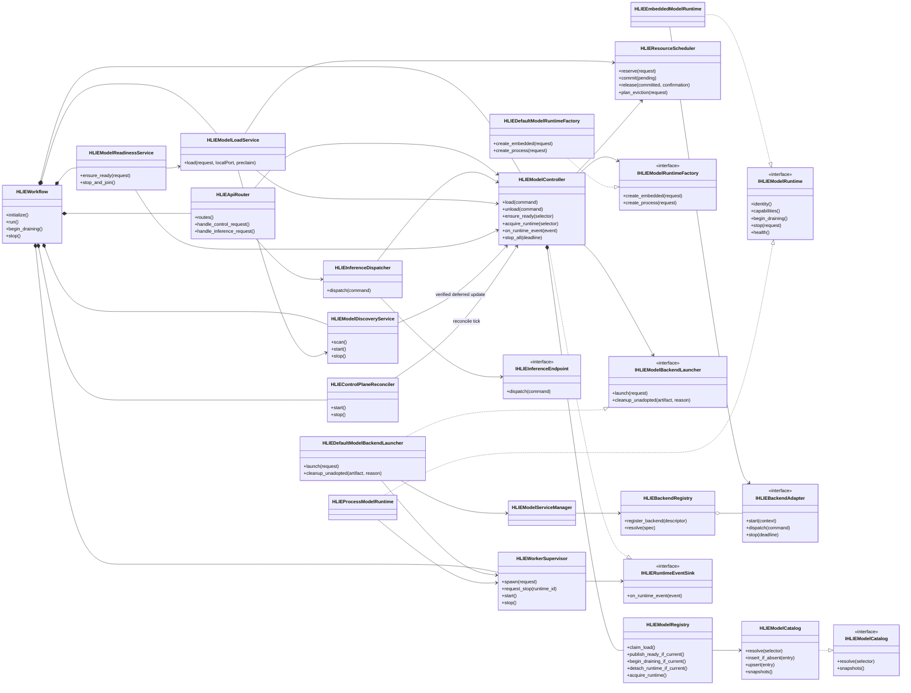

## 9. 生命周期状态机

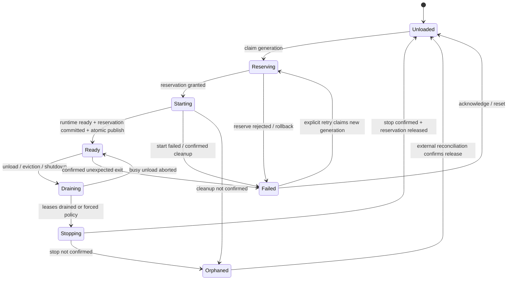

`Orphaned` 在外部 reconciliation 确认 runtime 已停止、硬件已释放之前，禁止直接进入新的 `Reserving`。

### 9.1 对外兼容映射

| P1 状态 | 旧状态兼容值 | 路由 | reservation |
| --- | --- | --- | --- |
| `Unloaded` | `unloaded` | 禁止 | 无 |
| `Reserving` / `Starting` | `loading` | 禁止 | pending/committing |
| `Ready` | `loaded` | 允许 | committed |
| `Draining` / `Stopping` | `unloading` 扩展；旧客户端可映射 `loading` 之外的 busy | 禁止新请求 | committed |
| `Failed` | `failed` 扩展 | 禁止 | 已确认释放 |
| `Orphaned` | `failed` 扩展，附 `resource_retained=true` | 禁止 | 保守保留 |

失败状态不能继续表现为 `status.value=unloaded` 加旁路 `failed=true`。P1 API adapter 可以保留兼容字段，但结构化状态必须明确。

### 9.2 READY 不变量

只有一次 `publish_ready_if_current()` 成功后才允许对外 READY。成功必须同时满足：

1. ticket 是当前 generation；
2. runtime handle 非空且 health 可用；
3. endpoint/capability 已建立；
4. reservation 已 committed 且绑定相同 model key/generation；
5. instance 不处于 draining；
6. request lease 可以原子获取。

任何条件失败都必须 fail closed。

## 10. 关键时序图

### 10.1 Embedded 模型加载

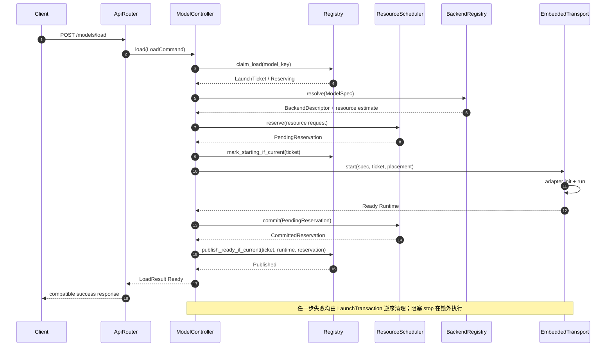

如果 commit 成功但 publish 因 stale ticket 失败，Controller 必须先停止 runtime，确认停止后 release committed reservation；不能直接释放。

### 10.2 Process Worker 加载与 READY

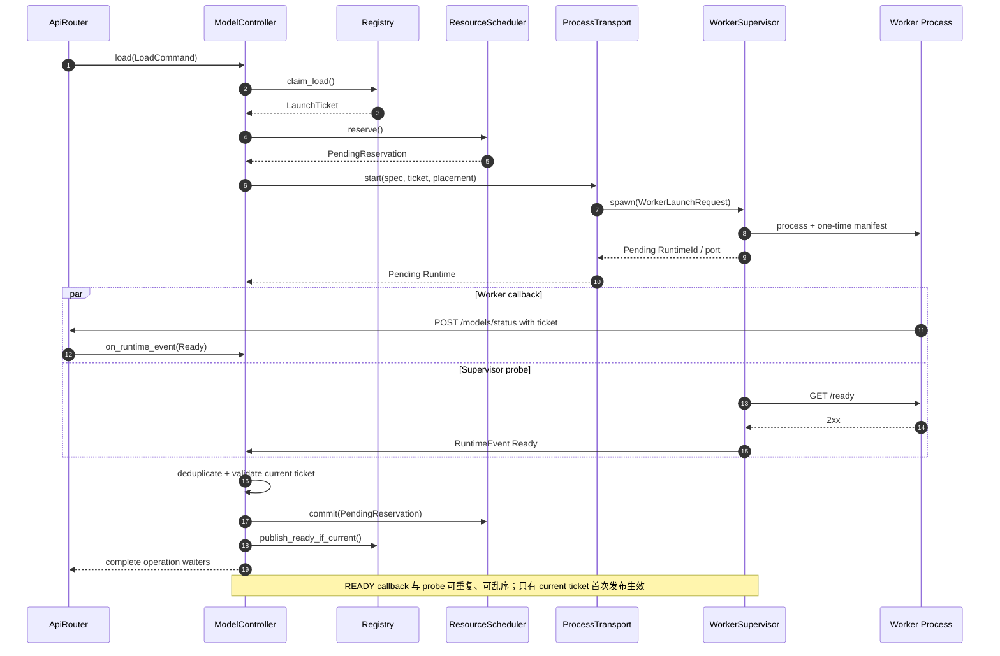

现有同步 `/models/load` 行为由 API adapter 等待 `HLIEModelOperationHandle` 保持兼容；Controller 内部不占用 HTTP worker 执行实际监督循环。

### 10.3 推理请求与 runtime lease

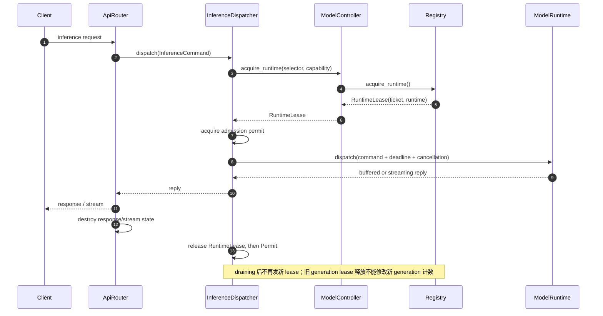

实现时应通过局部变量声明顺序或显式 response owner 保证析构顺序，不依赖注释约定。

### 10.4 统一卸载/驱逐

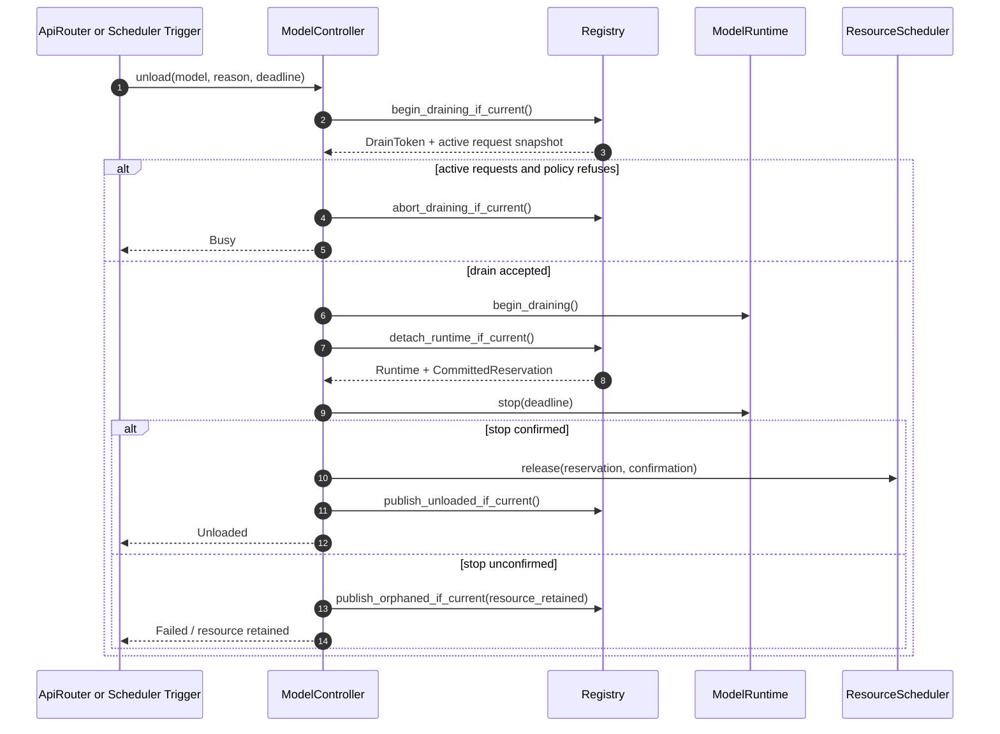

手工 unload、LRU、TTL、loaded-limit 和 shutdown 必须调用同一个 Controller operation，不再各自复制 detach/stop/release 逻辑。

### 10.5 Worker 异常退出

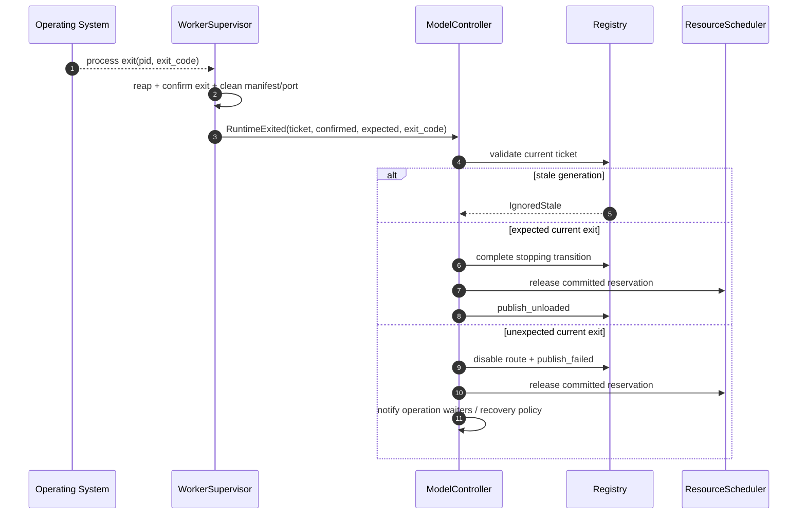

### 10.6 系统 shutdown

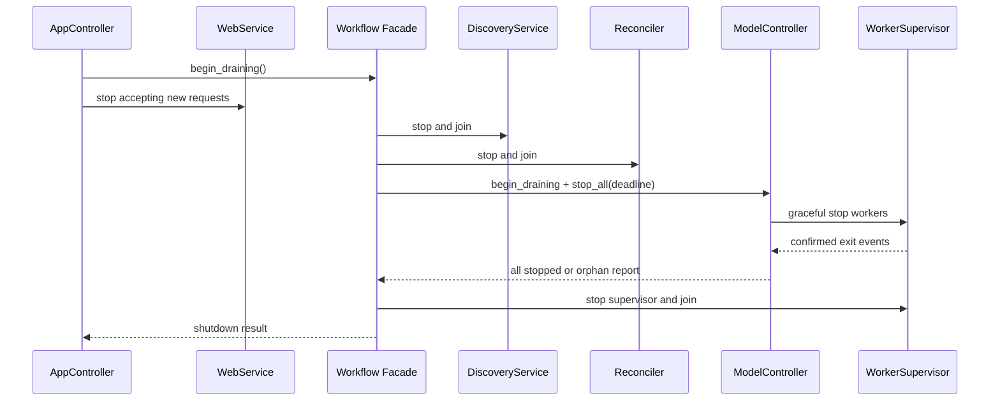

Supervisor 必须存活到 Worker stop/exit 收敛完成；不能先停监督线程再请求 Worker 退出。

## 11. 并发、锁和对象生命周期

### 11.1 并发模型

- 每个 model key 只有一个 current lifecycle operation；重复 load 加入同一个 operation future，不重复启动。
- 不同 model key 可以并行进行资源规划，但最终 reserve 由 Scheduler 原子串行化。
- Registry 使用短临界区；runtime/backend 操作全部在锁外。
- Supervisor 使用独立线程和 process table 锁；事件投递在锁外。
- DiscoveryService、Supervisor 和 ControlPlaneReconciler 各自拥有线程及 stop token，析构必须 join。
- 禁止捕获裸 `this` 的 detached thread。

### 11.2 推荐所有权

| 对象 | 唯一 owner | 对外形式 |
| --- | --- | --- |
| Registry | ModelController | snapshot / runtime lease |
| model lifecycle operation | ModelController per-model slot | shared operation handle |
| pending reservation | LaunchTransaction | move-only guard |
| committed reservation | current ModelRecord / detached stop context | opaque handle |
| embedded Service bundle | EmbeddedModelRuntime | `shared_ptr<IHLIEModelRuntime>` lease |
| process table、port lease、manifest | WorkerSupervisor | RuntimeId / event |
| backend descriptors | BackendRegistry | immutable descriptor snapshot |
| route table | ApiRouter | immutable route definitions |

### 11.3 禁止的调用

- Router -> Registry/ServiceManager/ProcessManager；
- Supervisor -> Registry/DeviceService；
- Scheduler -> Controller callback；
- BackendAdapter -> Registry/HTTP Router；
- Registry -> backend stop/process wait；
- 任意模块在锁内调用用户 callback、日志 sink flush 或外部 SDK。

## 12. 错误模型、日志、指标和 tracing

### 12.1 Typed error

控制面使用稳定错误类别：

- `NotFound`、`AlreadyReady`、`OperationInProgress`；
- `CapacityRejected`、`PlacementRejected`；
- `BackendStartFailed`、`ReadyTimeout`；
- `Busy`、`DrainTimeout`、`StopUnconfirmed`；
- `StaleGeneration`、`InvariantViolation`；
- `ShuttingDown`。

错误携带 operation id、ticket（不含 token 的可日志部分）、runtime id、reservation id 和可恢复性。API adapter 负责映射当前 HTTP code/error body。

### 12.2 日志规则

- lifecycle transition 由 Controller 记录一次；下层组件只记录自己拥有的事实。
- polling 无状态变化不打印；当前状态通过 metrics/health 暴露。
- DEBUG：路由选择、stale event、安全拒绝、规划细节。
- INFO：成功的状态迁移、启动、READY、graceful stop、reservation commit/release。
- WARN：容量拒绝、busy、fallback、orphan recovery、可恢复异常。
- ERROR：未恢复的启动失败、unexpected exit、ready timeout、stop unconfirmed、事务不变量破坏。
- launch token、prompt、流内容和敏感环境变量值不得进入日志。

### 12.3 指标

建议新增/收敛：

- `hlie_model_transition_total{from,to,reason,transport}`；
- `hlie_model_operation_duration_seconds{operation,transport,result}`；
- `hlie_model_operations_in_progress{operation}`；
- `hlie_runtime_ready_timeout_total{transport}`；
- `hlie_runtime_unexpected_exit_total{transport}`；
- `hlie_runtime_orphaned{transport}`；
- `hlie_resource_reservation_mb{state,device}`；
- `hlie_inference_in_flight{capability,transport}`；
- `hlie_inference_rejected_total{reason,capability}`。

Prometheus label 不使用 model key、PID、reservation id 等高基数值；这些标识放日志和 trace。

### 12.4 Tracing

统一传播 `request_id`、`operation_id`、`model_key`、`generation`、`runtime_id` 和 `transport`。建议 span：

```text
http.request
  model.ensure_ready
    resource.reserve
    runtime.start
    runtime.await_ready
    registry.publish_ready
  inference.dispatch
    embedded.backend | process.proxy
```

## 13. 建议代码布局

```text
include/hlie_base/
  # 现有 logger/config/util 及 TCIM/GGML/Kaldi 兼容 helper

include/hlie_core/
  domain/
    hlie_model_spec.h
    hlie_model_catalog.h
    hlie_model_instance.h
    hlie_model_lifecycle.h
    hlie_runtime_types.h
    hlie_error.h
  control/
    hlie_model_controller.h
    hlie_model_operation.h
    hlie_inference_dispatcher.h
    hlie_control_plane_reconciler.h
  resource/
    hlie_device_reservation_ledger.h
    hlie_resource_scheduler.h
    hlie_residency_policy.h
  runtime/
    hlie_model_runtime.h
    hlie_runtime_factory.h
    hlie_runtime_event.h
    hlie_runtime_event_sink.h
  backend/
    hlie_backend_descriptor.h
    hlie_backend_registry.h
    hlie_backend_adapter.h

include/hlie_app/
  api/
    hlie_api_router.h
    hlie_api_dto.h
    hlie_error_mapper.h
  bootstrap/
    hlie_builtin_backends.h
  discovery/
    hlie_model_catalog_store.h
    hlie_model_discovery_service.h
  process/
    hlie_process_manager.h
    hlie_worker_supervisor.h
    hlie_worker_port_allocator.h
  runtime/
    hlie_runtime_factory_impl.h
    hlie_embedded_worker_transport.h
    hlie_process_worker_transport.h
  backend/
    llm/
    whisper/
    cosyvoice/
    qwen3_tts/
    stable_diffusion/
  tcim/
    # 当前唯一 SDK 的 app-side adapter/workaround；可按需逐步归拢
```

目录表达职责，不代表每个目录都是独立库。P1 只有 base/core/app 三个主要生产 target；app 下的 api/process/runtime/backend/tcim 是内部模块。现有 `HLIEProcessManager`、`HLIEWorkerPortAllocator`、各模型 Service 和 document pipeline 先被新接口包装；只有 owner 已经迁移且移动能改善依赖时才调整路径，避免制造无行为价值的大 diff。

### 13.1 现有代码进入 hlie-core 的建议

| 现有内容 | 处理方式 | 前置治理 |
| --- | --- | --- |
| `runtime/hlie_model_launch_ticket.h` | 直接迁入 core/domain | 使用 core 强类型 model key |
| `runtime/hlie_admission_controller.h` | 迁入 core/control | 保持无 HTTP 依赖 |
| `hlie_device_reservation_ledger.*` | 迁入 core/resource | observation 使用 core DTO |
| `runtime/hlie_service_slot.h` | 迁入 core/runtime | 泛型 slot 不 include 具体 Service |
| `hlie_cancellation_metrics.*` | 迁入 core/control | metrics snapshot 与 exporter 分离 |
| `hlie_model_residency_manager.*` | 重构后迁入 core/resource | 不依赖 Registry concrete record |
| `hlie_model_registry.*` | 重构后迁入 core/domain | 移除 `server_model_meta`、`HLIEModelInfo` 和 logger side effect |
| `hlie_model_info_core.cpp` | 拆分 | core 保留 `HLIEModelSpec`；文件/GGUF 解析留 infrastructure |
| `hlie_model_family_registry.*` | 不进入 core | 属于 app 的 artifact/backend 匹配规则 |
| `hlie_process_manager.*`、port allocator | 不进入 core | app process implementation |
| `hlie_model_service_manager.*`、Factory | 不进入 core | app embedded runtime/backend implementation |

### 13.2 hlie-base 兼容策略与冻结边界

P1 不要求先把 TCIM、Kaldi、GGML 从 `hlie-base` 物理迁出。下面这些现有实现可以继续保留，以免 Workflow 重构同时触发大规模文件和链接关系搬迁：

| 当前 base 内容 | P1 处理 |
| --- | --- |
| `hlie_tcim_util.*`、`hlie_sampler.*`、`hlie_gguf_bundle.*` | 保留；只允许 app 具体 backend 或现有兼容调用方使用 |
| `hlie_gguf_util.*`、`hlie_tokenizer.*`、`hlie_audio.*` | 保留；不把文件解析结果直接作为 core domain type |
| `hlie_rk_performance.*`、TCIM logger handler | 保留；不得被 Controller/Registry/Router 直接调用 |
| logger/config/gzip/util/exception/blocking queue | 继续作为 app/core 可直接使用的通用基础能力 |

冻结规则：base 不新增模型生命周期、Registry、operation、reservation owner、HTTP route 或 Worker 监督逻辑；core public header 不 include TCIM/HAL/GGML/Kaldi 头。未来第二套 SDK 或 ABI 隔离需求出现时，再把这些兼容实现从 base 提取到独立实现 target。

### 13.3 CMake target 规则

建立真实生产 target `hlie-core`，生产代码、单测、ASAN/UBSAN 和 TSAN 都链接同一个 target；测试目录不得手抄任何已经归属 core 的 source。尚未满足 core 边界的 Registry 等源码可短期留在 `hlie-control-plane-test-support`，但它不是 core，且必须随职责迁移逐步清空。

- `hlie-core` 使用显式 source list，不使用 GLOB 隐式吸入 SDK 文件。
- `hlie-core` public header 不暴露 `hlie-app`、TCIM/HAL、llama、Kaldi、Whisper、SD、PDFium、uWebSockets 或 `cpp-httplib` 类型。
- shared/static 形式遵循最终打包策略，但一个进程只能存在一份 Registry/Controller 状态；P1 不承诺跨编译器的 C++ plugin ABI。
- CMake 直接依赖必须显式声明：`hlie-app` 链接 `hlie-core` 和 `hlie-base`，`hlie-core` 链接 `hlie-base`；禁止 base 反向链接 core/app 和 core 反向链接 app。
- `hlie-app` 内部的 api/process/runtime/backend/tcim 目录默认不拆独立 target；只有出现真实 ABI、裁剪、复用或独立交付需求时才提取。
- 增加 include/dependency audit，重点检查 core public header 和反向依赖；P1 不要求 `hlie-core` 二进制 import table 完全 SDK-free，因为 base 暂时保留现有传递依赖。

目标链接关系示意：

```cmake
target_link_libraries(hlie-core
    PRIVATE hlie-base
)

target_link_libraries(hlie-app
    PRIVATE
        hlie-core
        hlie-base
)
```


## 14. 分阶段迁移计划

P1 必须使用 strangler migration，任何阶段主分支都保持可构建、可运行、可回滚；禁止在一个改动中同时迁移所有 route 和 lifecycle。

### P1-0：基线、契约和 characterization tests

原定工作：

- 固化本文和 ADR；
- 为现有 load/unload/auto-load/status/eviction 行为补 characterization tests；
- 保存 P0 hardware smoke/soak 和 API golden responses；
- 建立 base/core/app 三层 CMake 依赖方向和禁止反向依赖规则；
- 建立真实 `hlie-core` target、fake ports 和 core public-header 审计门禁；
- 让现有 unit/stress/sanitizer 先链接最小 `hlie-core`，再逐步扩大真实生产核心覆盖。

退出条件：现有行为在 fake backend、Fake Worker 和 API golden test 中可重复；生产和测试链接同一个 `hlie-core` target；base/core/app 不存在反向依赖，core public header 不泄露专有 SDK 类型。

### P1-1：领域类型与 BackendRegistry

工作：

- 引入 lifecycle/runtime/capability typed types；
- 显式注册 LLM、SD、Whisper、CosyVoice、Qwen3-TTS descriptor；
- 将模型分类、memory estimator、transport support 和 companion 声明迁入 descriptor；
- 保持单一 HOUMO TCIM SDK 路径，TCIM/HAL 初始化和硬件可用性检查继续由 app 具体实现负责；
- Factory 保留兼容 façade，内部委托 BackendRegistry。

退出条件：新增 backend 不需要修改 Workflow 的模型类型 switch；当前 backend 选择、资源估算和 TCIM 启动结果与旧逻辑 golden test 一致。

### P1-2：独立 WorkerSupervisor

工作：

- 从 Workflow 迁移 supervisor thread、poll config、ready timeout、port allocation、manifest cleanup 和 shutdown；
- 定义 `IHLIERuntimeEventSink`；
- Supervisor 只发事件，兼容 adapter 暂时把事件转回旧 Workflow handler。

退出条件：现有 Fake Worker 组件场景全部通过；Supervisor 模块不 include 或访问 Workflow、Registry、DeviceService。

### P1-3：ResourceScheduler 与 reservation 所有权

工作：

- 把 `model_reservations_`、reservation bind/commit/release、placement 和 residency plan 迁入 Scheduler 契约；
- 引入 pending/committed 类型化 handle；
- 迁移期间由旧 residency timer 提交 generation-fenced owner snapshot，Scheduler 完成 expired pending 对账；
- 由旧 Workflow adapter 暂时执行 eviction plan，P1-5/P1-7 再分别迁到 Controller/Reconciler。

退出条件：Workflow 不再直接调用 DeviceLedger reservation API，不再拥有 reservation map。

#### P1-3 阶段落地类关系

下图记录 P1-3 退出时的迁移态；其中 Workflow event sink 与
`evict_model()` adapter 已在 P1-5 被 ModelController 替换，不代表当前结构。

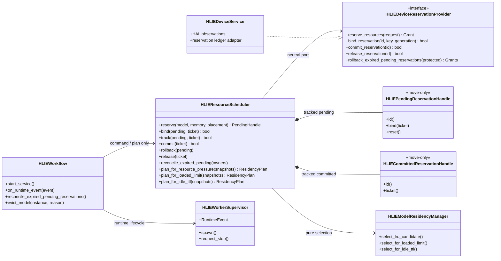

约束：

- Scheduler 不依赖 Workflow、Registry、ProcessManager、HTTP、concrete Service 或 TCIM/GGML 类型；
- Supervisor 不依赖 Scheduler；两者通过上层的 generation ticket 协调，不互相回调；
- Workflow 可以执行 Scheduler 返回的 plan，但 Scheduler 不调用 `evict_model()`；
- `HLIEDeviceService` 是当前单一 HOUMO SDK 下的资源 adapter，不是额外的 backend/platform 库；
- `PendingHandle` 析构不偷偷访问全局 ledger，所有 rollback/transfer 都必须显式经 Scheduler，便于审计事务边界。

#### 动态 Worker reservation 时序

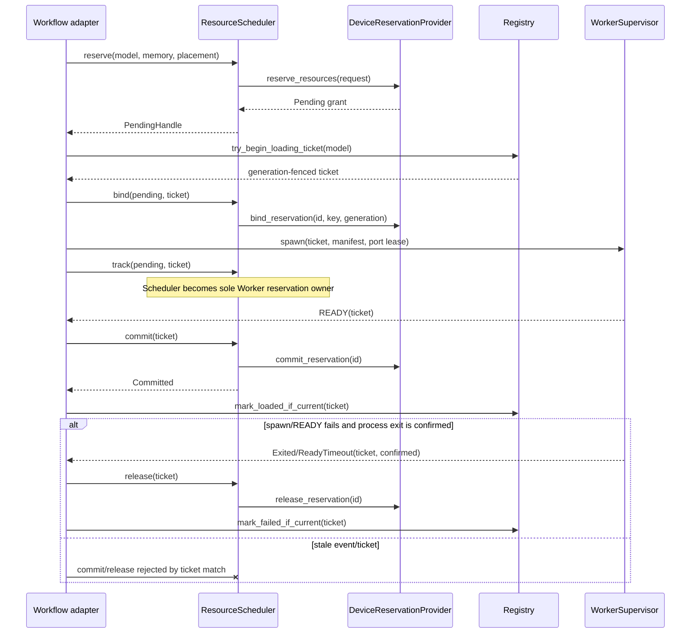

关键不变量：reservation 的 generation bind 发生在 spawn 前；Worker reservation 只在 READY 后 commit；未确认 Worker 已退出时不得释放其资源；旧 generation 的 READY/exit 不能修改新 generation binding。

#### 本地 runtime 外部 grant 所有权时序

```mermaid
sequenceDiagram
    participant W as Workflow adapter
    participant S as ResourceScheduler
    participant L as Embedded concrete Service
    participant RD as RuntimeDirectory
    participant D as DeviceReservationProvider

    W->>S: reserve + bind(PendingHandle, ticket)
    W->>L: start(model_info with borrowed reservation id)
    alt init/run succeeds
      W->>RD: publish EmbeddedModelRuntime(ticket)
      W->>S: track(pending, ticket)
      W->>S: commit(ticket)
      S->>D: commit_reservation(id)
      Note over L,S: Service uses the external grant; Scheduler remains its sole owner
    else init/run fails
      W->>S: rollback(pending)
      S->>D: rollback_reservation(id)
    end
```

P1-4 已删除原 `transfer_to_local_runtime()` 过渡点。外部 grant 对 concrete Service 是 borrowed：Service 只校验并使用，不直接 commit/release；Scheduler 在 Runtime 发布成功后完成 track/commit，并在 confirmed stop 后按 ticket release。默认启动模型没有外部 grant 时仍允许 Service 自申请、自释放，以保持启动兼容。

### P1-4：Runtime abstraction

工作：

- 用 EmbeddedModelRuntime 包装 ServiceManager/ServiceSlot；
- 用 ProcessModelRuntime 包装 Supervisor runtime identity；
- 统一 stop/health/capability；
- 将 LLM + DocumentPipeline 建模为一个 embedded runtime bundle。

退出条件：默认启动和动态加载的 embedded/process 实例都发布 generation-fenced Runtime handle；drain、confirmed stop、unload、eviction、shutdown 和健康观测优先通过 Runtime；外部 reservation 只由 Scheduler commit/release；Runtime core contract 不依赖 HTTP DTO、具体 Service 或 SDK。推理 handler 的 typed Service getter 与统一 dispatch 明确留在 P1-6，不作为 P1-4 的伪门槛。

#### P1-4 实际落地结构

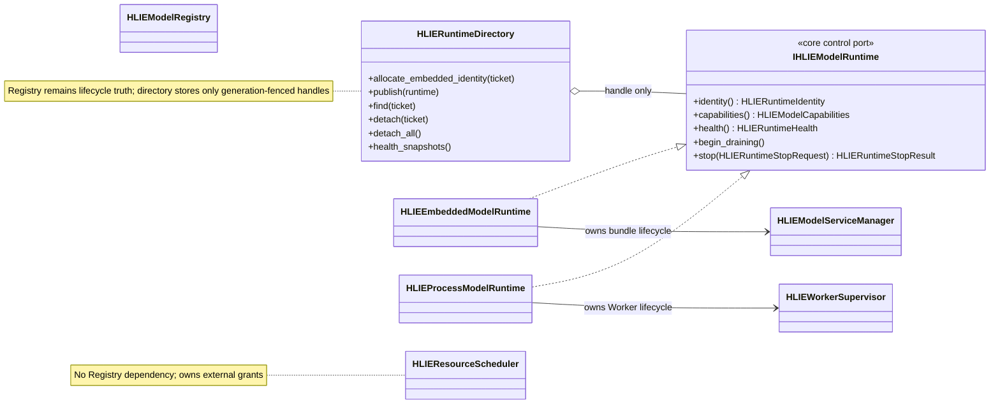

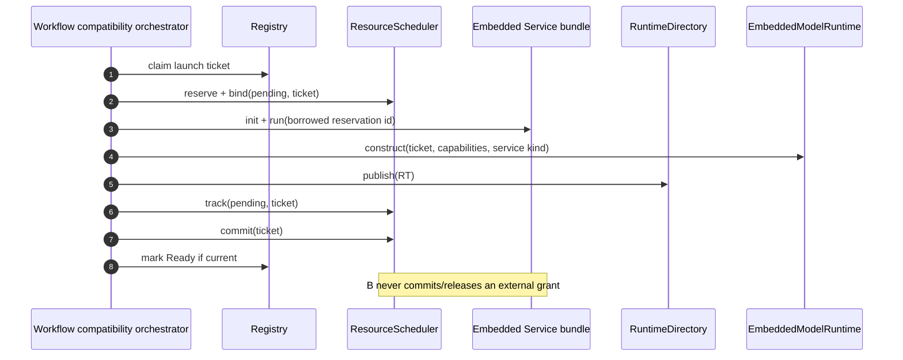

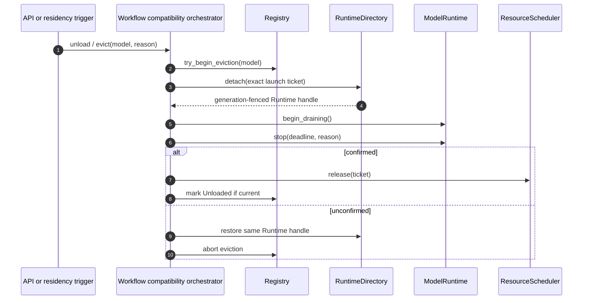

### P1-5：ModelController 接管生命周期

工作：

- 将 generation claim、load transaction、READY publish、rollback、unload、eviction 和 runtime event 收敛到 Controller；
- Registry 变为 Controller 私有成员；
- 自动加载改为 `ensure_ready()` operation coalescing；
- 统一主进程本地模型和动态 Worker 状态机；
- 明确 Failed/Orphaned 状态。

退出条件：所有 Registry 状态写入只来自 Controller；Workflow 不再包含模型专用 `start_*`、`evict_model`、reservation ownership helper 或 Supervisor polling loop。Workflow 可以在 composition root 启停 Supervisor，也可以把 transport placement intent 提交给 Scheduler，但不能自行 bind/track/commit/release。

#### P1-5 当前落地结构

P1-5 代码切分已经完成。Registry 对象只存在于 Controller 内；动态
load、unload、eviction、Worker event、confirmed stop 和等待合流均由
Controller 拥有。BackendLauncher 是一个 app-layer side-effect port，不是
第二个 Controller：它只启动具体 backend 并返回 artifact，不能写
Registry、Scheduler 或 RuntimeDirectory。

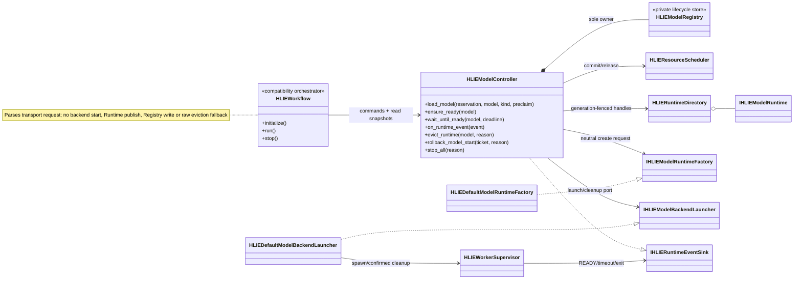

#### 完整加载事务时序

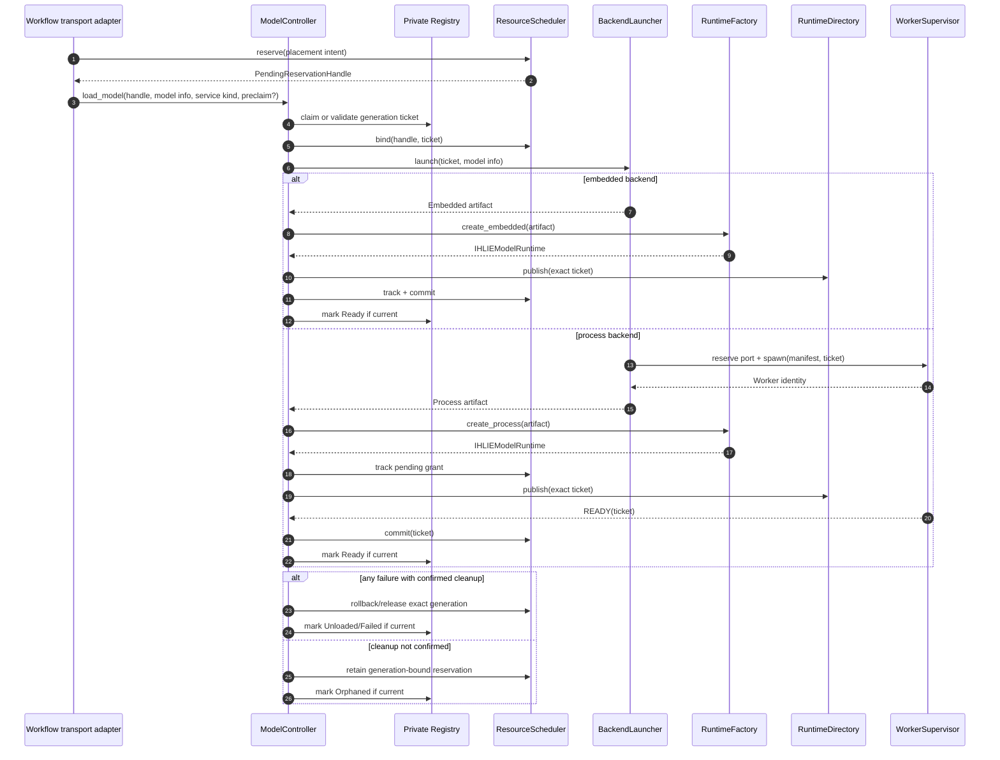

关键约束：Controller 在调用 Launcher 前完成 generation claim/bind；Launcher
不能自行 commit/release。backend 已启动但 Runtime adapter 创建或发布失败时，
只有 Launcher/Runtime 返回 confirmed cleanup，Controller 才能释放 grant；否则
必须保留 pending/committed ownership 并进入 `Orphaned`。

#### ensure_ready 并发合流时序

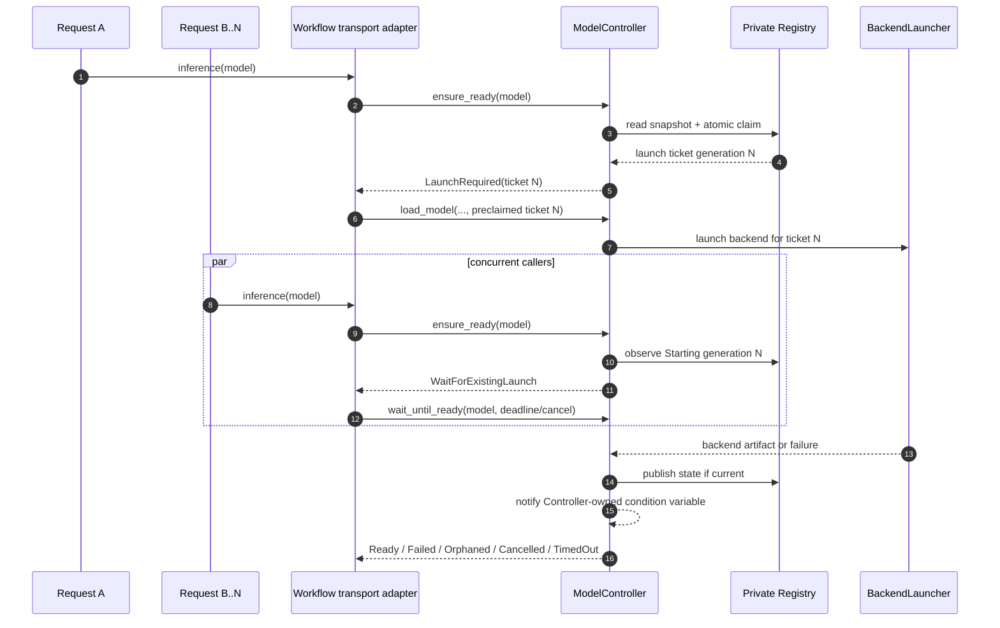

`ensure_ready()` 的不变量是同一 model key 同时只有一个调用者得到 launch
ticket；其他调用者既不创建后台启动任务，也不生成新 generation。等待者
只消费中性 lifecycle snapshot，并能区分 Missing、Failed、Unloaded、
Orphaned、Unavailable、取消和超时。

#### Worker 退出所有权时序

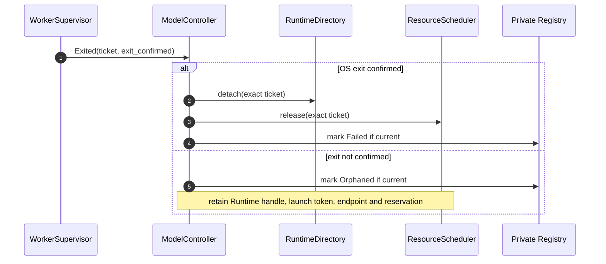

RuntimeFactory 与 BackendLauncher 两个 app port 已落地。Workflow 不再直接
构造 Embedded/Process adapter，不调用具体 Service `start_*`，不租用 Worker
端口、不 spawn Worker，也不执行 `begin_load/adopt_*`。Controller 仍不得
include HTTP、ModelServiceManager、ProcessManager、DeviceService 或 TCIM；这些
具体依赖只允许存在于默认 Launcher/Factory implementation 和 composition root。

### P1-6：InferenceDispatcher 与 ApiRouter

P1-6 是业务可用性阶段。P1-0 至 P1-5 保证模型生命周期和资源账本不乱，
P1-6 保证真实推理请求在 load/unload、Worker crash、stream disconnect、draining
和 generation replacement 期间不误路由、不提前释放资源、不改变已有 API。

#### 目标结构

```mermaid
classDiagram
    direction LR

    class HLIEWebService {
      -IHLIEHttpRouteProvider route_provider
      -IHLIEWebServiceStateProvider state_provider
      -IHLIEAuthPolicy auth_policy
    }
    class HLIEApiRouter {
      +get_route_configs()
    }
    class HLIEInferenceDispatcher {
      +acquire(model, operation) AcquireResult
      +dispatch(model, operation, request) DispatchResult
      +reconcile_endpoints()
      +metrics() Metrics
    }
    class HLIEInferenceSession {
      +identity() RuntimeIdentity
      +endpoint() InferenceEndpoint
      +lifetime_guard() shared_state
    }
    class IHLIEInferenceEndpoint {
      +identity() RuntimeIdentity
      +supports(operation) bool
      +dispatch(operation, request, method) Response
      +dispatch_realtime_transcription(...)
      +dispatch_speech(...)
    }
    class HLIEDefaultInferenceEndpointResolver {
      +resolve(identity, service_kind) InferenceEndpoint
    }
    class EmbeddedEndpoint
    class ProcessEndpoint
    class HLIEModelController
    class HLIERuntimeDirectory

    HLIEWebService --> HLIEApiRouter
    HLIEApiRouter --> HLIEInferenceDispatcher
    HLIEInferenceDispatcher --> HLIEModelController : generation request lease
    HLIEInferenceDispatcher --> HLIERuntimeDirectory : exact runtime handle
    HLIEInferenceDispatcher --> HLIEDefaultInferenceEndpointResolver
    HLIEDefaultInferenceEndpointResolver --> EmbeddedEndpoint
    HLIEDefaultInferenceEndpointResolver --> ProcessEndpoint
    HLIEInferenceSession --> IHLIEInferenceEndpoint
```

`IHLIEInferenceEndpoint` 是 app 数据面边界，不进入 `hlie-core` 的 Runtime 控制
契约。它跨 Embedded/Process backend 中性，但适配现有 `server_http_req`/
`server_http_res`，目的是不复制 multipart/body、不引入本地 HTTP hop，也不改写
llama/Whisper/SD/TTS handler。具体 Service header 和 `ServerHttpProxy` 只允许出现在
默认 resolver 实现中。

#### 请求时序与线性化点

```mermaid
sequenceDiagram
    participant HTTP as WebService/ApiRouter
    participant D as InferenceDispatcher
    participant C as ModelController
    participant RD as RuntimeDirectory
    participant ER as EndpointResolver
    participant E as Embedded/Process Endpoint
    participant R as Streaming Response

    HTTP->>D: dispatch(model, operation, request)
    D->>C: begin_request_ticket(model)
    C-->>D: generation-fenced launch ticket
    D->>RD: find(exact ticket)
    RD-->>D: shared Runtime handle
    D->>ER: resolve(identity, service kind)
    ER-->>D: generation-bound endpoint
    D->>E: dispatch(operation, request)
    E-->>D: response / stream
    D-->>HTTP: guarded response
    Note over R,D: upstream response/proxy is destroyed first
    R-->>D: EOF, cancellation, disconnect or destruction
    D->>C: end_request(exact ticket)
```

`begin_request_ticket()` 是 dispatch 的生命周期线性化点。它必须发生在 endpoint
使用之前；同一 ticket 必须同时命中 Runtime 和 Endpoint identity。任何缺失、stale
generation 或 operation mismatch 都 fail-closed，并立即归还 lease。
Embedded resolver 还必须验证具体 Service snapshot 的 canonical model key 与 ticket
一致；仅 service kind 相同不足以建立 endpoint identity。SD 当前是固定 `sd3` slot，
其他 Service 使用各自 `get_model_key()` 校验。同类 slot 异常或切换中的不一致必须
返回 `EndpointUnavailable`，不能把请求 identity 直接赋给不相干的 Service。

#### 所有权与取消不变量

- `HLIEInferenceSession` 是 move-only façade，内部 shared state 只用于真正跨异步
  callback 的 httplib chunked response、Qwen3-TTS stream 和 proxy stream。
- 普通 `server_http_res` 由 guarded response 持有。成员析构顺序固定为：上游
  response/proxy -> endpoint -> Runtime handle -> `end_request()`。
- 客户端断连先触发已有 Service/Proxy cancellation，再释放 request lease；不得先让
  eviction 看到 `active_requests == 0`。
- streaming response、admission permit 和 session lifetime guard 必须共同活到 EOF、
  completion callback 或取消 callback。
- Dispatcher 不自动重试推理。生成、流式和可能有副作用的请求不能假定可重放；
  将来只有显式标记 replay-safe 的 operation 才能配置 retry。
- unload/eviction 继续由 Controller 检查 active request；Dispatcher 不拥有 lifecycle
  状态，也不能停止 Runtime 或释放 reservation。

#### Embedded 与 Process 行为

- Embedded endpoint 对现有 Service 做 `shared_ptr` snapshot 后直接调用原 handler；
  不序列化、不走 loopback HTTP、不进入 token/decode loop。
- Process endpoint 沿用 `ServerHttpProxy` 的 timeout、stream idle、trailer、cancel 和
  join 语义。
- 无模型的旧 alias、SD/Whisper/Qwen debug 默认路由继续只选择 Embedded Runtime；
  只有显式模型 ID 可以解析到 Process Runtime，避免改变历史默认行为。
- PDF Document preprocess/OCR 与主 LLM 共用同一 generation session；Document OCR
  endpoint 同时持有 Document 与 LLM Service snapshot。

#### 错误与指标

Dispatcher 只返回 typed status：`Draining`、`ModelNotFound`、`ModelNotReady`、
`RuntimeUnavailable`、`EndpointUnavailable`、`UnsupportedOperation` 和
`EndpointFailure`。`HLIEInferenceHttpErrorMapper` 是到现有 OpenAI-compatible error
body/status 的唯一映射点。

核心指标：

- `hlie_inference_dispatch_active_sessions`；
- `hlie_inference_dispatch_total`；
- `hlie_inference_dispatch_rejected_total{reason=...}`；
- `hlie_inference_dispatch_failures_total`；
- `hlie_inference_dispatch_cached_endpoints`。

无状态变化时不打印周期日志。stale/unsupported 是 DEBUG 或正常错误响应；Runtime/
Endpoint 消失为 WARN；endpoint 抛异常或返回空响应为 ERROR。prompt、body、stream
payload 和 token 不进入生命周期日志。

#### 分批实施

1. P1-6a：Inference operation、Endpoint、DispatchSession 和 typed result；
2. P1-6b：Embedded/Process endpoint adapter 与 generation cache；
3. P1-6c：LLM、SD、Whisper、Document、Qwen debug 迁移；
4. P1-6d：speech、WebSocket、stream cancellation 和 lifetime guard；
5. P1-6e：ApiRouter、HTTP error mapper、WebService 窄 provider；
6. P1-6f：API golden、故障注入、并发、sanitizer、性能和真机回归。

#### 退出条件

- Workflow 不直接调用具体 Service inference handler，不构造 `ServerHttpProxy`，不再
  自行定义 `ModelRequestLease`/stream response guard；架构门禁阻止职责回流。
- WebService 不 include/持有 Workflow，只依赖 RouteProvider、StateProvider 和
  AuthPolicy；ApiRouter public header 不 include Controller、ServiceManager 或具体
  Service。
- public API route/path/method、DTO、错误码、stream trailer 和 cancellation golden
  与重构前一致；route golden 精确覆盖 30 组、48 个 public path 和所有 operation
  mapping，不能只比较 route 数量。
- Embedded 数据面不增加 HTTP hop；steady-state endpoint 按 generation 缓存，热路径
  仅增加一次 map lookup、request lease 和请求边界虚调用。
- Dispatcher/lease 的 p50/p99 和吞吐回归均不超过 3%；2 小时 mixed workload 无
  handle/thread 持续增长，warm-up 后 RSS 无线性增长。
- unload/inference、Worker crash/stream、generation replacement、shutdown/waiter
  并发测试通过，Windows/Linux、ASAN+UBSAN、TSAN 和真机 API golden 全绿。

#### P1-6f 验证记录（2026-08-18）

- Windows Release 产品和 unit target 构建通过，完整 CTest 11/11；Linux Release
  产品构建通过，完整 CTest 10/10。
- P1-6 定向测试共 8 个用例、292 条断言。ApiRouter golden 精确覆盖 30 组、
  48 个 public path、HTTP method 和全部 inference operation mapping；Dispatcher
  覆盖 stream teardown、async guard、stale/fail-closed、cache/reconciliation 和
  2000 次 cached request-boundary，Windows 平均开销 3 us。
- Linux ASAN+UBSAN 3/3、TSAN 9/9 通过，无 sanitizer、undefined behavior 或
  data race 报告。
- 真机 `artifacts/p1_6_stream_cancel_golden_exact` 验证 Embedded/Process SSE 首块
  后断连、活动 session 持有/归零、随后普通推理恢复，以及 health/Prometheus 指标
  一致；Worker crash/recovery、graceful unload、ledger 与日志契约全绿。
- P1-5/P1-6 各 1400 个 warm-up 后同机样本中，P1-6 Embedded 的
  mean/p50/p99 变化为 `-0.423%/-0.259%/-0.621%`，Process 为
  `-0.427%/-0.414%/+0.559%`，满足 3% 门槛。
- exact-source 2 小时 mixed workload 在隔离端口 18931 完成 1975 个
  Worker load/infer/unload cycle。handles `20 -> 20`、threads `32 -> 33`、
  RSS `456540160 -> 461012992` bytes、private bytes
  `431964160 -> 434913280` bytes；最后 20% RSS/private 均只增加 12288 bytes。
  最终 ledger 回基线、manifest 零泄漏、forced shutdown 为 0，产物位于
  `artifacts/p1_6_mixed_workload_soak_2h_exact`。

### P1-7：Discovery、composition root 和清理

#### WorkerControlService status boundary

历史 Worker status 与 shutdown 兼容逻辑现已收敛到
`HLIEWorkerControlService`。该服务只接收 typed status、launch ticket、
processor snapshot 和生命周期回调；它不解析 HTTP/JSON，不访问
`HLIEProcessManager`、具体模型 Service 或 TCIM。`IHLIEWorkerStatusPublisher`
由 app-owned HTTP adapter 实现，Workflow 仅负责 DTO 映射和本地观察值采集。

READY 延迟发布、同步 LOADED/UNLOADED 发布、generation fencing、UNLOADED
后的 process-model 清理以及 shutdown ticket 幂等均由该服务拥有。详见
`docs/P1-7_WORKER_CONTROL_SERVICE.md`，并由
`hlie.architecture.worker-control-service-dependencies` 门禁保护。

默认 embedded startup 同步拆为 `HLIEEmbeddedStartupService` 与
`HLIEDefaultEmbeddedStartupTargetProvider`：前者拥有已初始化 Service 的
Runtime publication/rollback，并在未发布 Runtime 的失败路径即时清理
Service slot；后者只负责当前 ServiceManager slot 的 typed 兼容投影。primary
LLM、admission 配置、secondary model 的原始顺序保持不变；最终 shutdown
residual sweep 仅作为未确认所有权的安全网。
架构与时序详见 `docs/P1-7_EMBEDDED_STARTUP_SERVICE.md`。

Document request boundary 已拆为 `HLIEDocumentApplicationService`。它拥有
PDF sniff、`document_preprocess_only` 兼容解析、Document operation 选择、
Dispatcher 委托和 document companion stop callback；PDFium/layout/OCR
仍由原 Pipeline/Endpoint 实现负责。正常路由观测为 DEBUG，详细类图与时序见
`docs/P1-7_DOCUMENT_APPLICATION_SERVICE.md`。

ASR request/realtime boundary 已拆为 `HLIEAsrApplicationService`。它拥有
Whisper/LLM selection、Qwen3-ASR + ForceAligner 两阶段编排、admission、
PCM-to-WAV、stream decode 和 realtime listener lifecycle；uWebSockets 只由
`HLIEDefaultAsrRealtimeTransport` adapter 持有。详细类图与时序见
`docs/P1-7_ASR_APPLICATION_SERVICE.md`。

Speech request boundary 已拆为 `HLIESpeechApplicationService`。它拥有
CosyVoice/Qwen3-TTS selection、loading wait、generation target、Qwen
admission guard、backend response header 与 dispatch/error mapping；具体
Service/Worker proxy 继续位于 Endpoint adapter。详细类图与时序见
`docs/P1-7_SPEECH_APPLICATION_SERVICE.md`。

默认模型初始化 boundary 已拆为 `HLIEDefaultModelInitializationService`。
它拥有 configured primary/SD3 selection、default mmproj 校验、LLM 参数准备、
Service slot init 与 typed zero-load/failure result；后续 Service `run()` 和
generation Runtime publication 仍由 `HLIEEmbeddedStartupService` 负责。详细类图、
时序与兼容矩阵见 `docs/P1-7_DEFAULT_MODEL_INITIALIZATION_SERVICE.md`。

`/v1/models` read boundary 已拆为 `HLIEModelListApplicationService`。它拥有
legacy JSON mapping、loaded-record preference、本地/Worker instance merge、
alias resolution 与 `loaded_info` extensions；Controller/ServiceManager/
ProcessManager 仅由 composition adapter 产出只读 snapshot。详细类图与时序见
`docs/P1-7_MODEL_LIST_APPLICATION_SERVICE.md`。

单模型 unload boundary 已拆为 `HLIEModelUnloadApplicationService`。它拥有
legacy `model_id`/`model`/`model_type` selector、`document -> llm` 与
`tts -> cosyvoice` alias、HTTP/error mapping 和 Worker unloaded 通知顺序；
Controller 继续唯一拥有 eviction claim、generation fencing、Runtime stop/detach、
reservation release 与 Registry publication。详细类图、时序和兼容矩阵见
`docs/P1-7_MODEL_UNLOAD_APPLICATION_SERVICE.md`。

`/hlie/v1/stop` boundary 已拆为 `HLIEStopServiceApplicationService`。它拥有
本地 all-model claim/eviction coordination、ticketed Worker stop、Supervisor
compatibility fallback、legacy pre-stop model snapshot reconciliation 与原有 HTTP
DTO；Controller/Supervisor 继续分别拥有 lifecycle/process stop。详细类图、时序、
兼容矩阵和两个内部 ownership 修复见
`docs/P1-7_STOP_SERVICE_APPLICATION_SERVICE.md`。

live/ready/health/metrics boundary 已拆为 `HLIEObservabilityApplicationService`。
readiness 使用轻量 model summary；health JSON 与 Prometheus 共用 composition
组装的中性 immutable snapshot，且不直接依赖 Controller/Scheduler/Supervisor/
Dispatcher 等 owner。完整 DTO 与 exact metrics 契约见
`docs/P1-7_OBSERVABILITY_APPLICATION_SERVICE.md`。

LLM compatibility boundary 已拆为 `HLIELlmApplicationService`。它拥有 model
selection、discovery retry、POST-only auto-load adaptation、readiness legacy error
mapping、response-lifetime admission、document-aware dispatch 与 `/props`/`/slots`；
Controller/Readiness/Dispatcher/Document owner 只通过 composition callback 暴露中性
能力。ASR 使用 `handle_admitted()` 保留单 permit 的跨阶段所有权。详细类图、时序和
兼容矩阵见 `docs/P1-7_LLM_APPLICATION_SERVICE.md`。

bootstrap initialization boundary 已拆为 `HLIEBootstrapApplicationService`。
它拥有 main/Worker process-role selection、launch ticket/manifest、initial catalog
registration、discovery baseline ordering 和 default initialization result mapping；
具体 parser、Controller registration、Service initialization 和 Discovery 只通过
composition adapter 注入。一次性 manifest 失败也消费，legacy `--json_info` 不删除。
详细类图与时序见 `docs/P1-7_BOOTSTRAP_APPLICATION_SERVICE.md`。

process lifecycle boundary 已拆为 `HLIEApplicationLifecycleService`。它拥有
one-shot run、monotonic draining、concurrent/idempotent stop 和跨 owner 的固定关闭
顺序；Workflow 只提供 run-time admission options 并委托 typed start/stop。ASR realtime
ingress 在 Controller 销毁 Whisper/LLM Runtime 前停止，避免新 realtime work 与 Service
释放并发。残余初始化但未发布的 Service slot 仍由 composition compatibility adapter
清理。详细类图、时序和失败矩阵见 `docs/P1-7_APPLICATION_LIFECYCLE_SERVICE.md`。

Worker control 现为两层：`HLIEWorkerControlService` 保持 transport-neutral
ticket fencing/lifecycle，`HLIEWorkerControlApplicationService` 拥有 GET status、
POST status 和 internal shutdown 的 legacy JSON/error/log mapping。Workflow 不再
解析 launch token 或组装 processor DTO，详细时序见
`docs/P1-7_WORKER_CONTROL_SERVICE.md`。

工作：

- 抽离 ModelCatalog/DiscoveryService 和 ControlPlaneReconciler；
- 清理 compatibility getter、旧 Factory/Manager 分支和过渡 feature flag；
- Workflow 收缩为组装和 lifecycle façade；
- 更新 ARCHITECTURE、运维说明和 backend 接入指南。

其中 Catalog/Discovery/Reconciler、composition root、Worker control、default
initialization、embedded startup、Document、ASR/realtime、Speech、model-list、
model-unload、stop-service、observability、LLM compatibility、bootstrap initialization、
application lifecycle 和 worker-control HTTP boundary 已完成；后续继续处理残余
compatibility adapter。

退出条件：本文 DoD 全部满足，P0/P1 全量门禁通过。

当前实施状态（2026-08-19）：

- 已完成 `HLIEControlPlaneReconciler`，Workflow 不再拥有 TTL/reconciliation thread；
- 已完成 `HLIEModelDiscoveryService`，Workflow 不再拥有 discovery thread、CV、generation、snapshot 或 stability state；
- 已完成 core `IHLIEModelCatalog` 只读 port 与 app `HLIEModelCatalog`，Registry 不再保存静态 catalog map；
- 已完成 `HLIEApplicationCompositionRoot`，Controller/Scheduler/RuntimeFactory/Launcher/Dispatcher/Reconciler/Discovery 的构造顺序不再散落在 Workflow；
- 已完成 `HLIEModelLoadService`：显式 load 与 auto-load 复用 typed request/result，资源规划、reservation acquisition 和 `Controller::load_model()` 提交不再由 Workflow 执行；Controller 继续唯一拥有 generation、Registry、Runtime adoption 和 reservation commit/release；
- 已完成 `HLIEModelReadinessService`：auto-load task group、preclaim rollback、coalesced `ensure_ready()/wait_until_ready()`、client/drain cancellation 和 stop/join 已退出 Workflow；LLM auto-load 与 speech loading wait 共用 typed readiness 状态；
- 新增 Reconciler、Discovery、Catalog、Composition 四条架构门禁；Windows Release CTest 15/15 通过；
- 新增 ModelLoadService 第五条 P1-7 门禁，禁止其依赖 Workflow、HTTP/JSON、Singleton、ProcessManager、DeviceService、ServiceManager、具体 backend Service 或 TCIM/GGML，并禁止 reservation/load transaction 回流 Workflow；
- 新增 ModelReadinessService 第六条 P1-7 门禁，禁止 readiness 反向依赖 transport/backend，并禁止 auto-load thread、Controller ensure/wait 回流 Workflow；
- WorkerControlService、DefaultModelInitializationService、
  EmbeddedStartupService、DocumentApplicationService、AsrApplicationService 与
  SpeechApplicationService、ModelListApplicationService、ModelUnloadApplicationService、
  StopServiceApplicationService、ObservabilityApplicationService、LlmApplicationService、
  BootstrapApplicationService、ApplicationLifecycleService 已完成各自 ownership
  cutover；WorkerControlApplicationService 也已接管 legacy status/shutdown HTTP；
  Workflow 当前约 1265 行，不再直接执行默认模型选择/Service init、
  `/v1/models`/processor DTO、worker status/shutdown mapping、PDF/ASR/Speech
  selection、pipeline、realtime handler、Speech session 或 document companion
  stop、单模型 unload selector/eviction mapping 或 stop-service batch/Worker
  reconciliation、health/readiness/Prometheus rendering、LLM compatibility routing
  main/Worker bootstrap orchestration 或 process-level run/drain/stop orchestration。
- legacy DTO/lifecycle façade 仍保留少量兼容桥接。P1 本轮按 owner、依赖和行为
  门禁完成验收；约 500 行目标转为 P2 的持续削薄门禁，不以机械行数否定已经
  完成的职责迁移。

## 15. 测试与验证矩阵

### 15.1 单元测试

- lifecycle transition table：合法迁移、非法迁移、stale generation；
- operation coalescing：并发 load 只启动一次；
- pending reservation 自动 rollback、committed reservation 不误释放；
- eviction plan：pinned、active lease、default model、LRU/TTL；
- BackendRegistry：匹配优先级、冲突、缺 capability；
- error mapper 与 API DTO compatibility；
- shutdown ordering 和 stop idempotency。

### 15.2 组件测试

- FakeEmbeddedRuntime：start success/fail/hang、stop success/hang；
- FakeProcessRuntime：READY 前退出、READY 后退出、重复 READY、stale READY、挂起强杀；
- FakeScheduler：capacity reject、need eviction、commit fail；
- HOUMO TCIM adapter：SDK 初始化失败、HAL 查询失败、资源不足和 backend init 失败；
- Controller + real Registry/Scheduler + fake runtime 的事务回滚；
- Dispatcher 的 response/lease/permit 析构顺序；
- Discovery 重扫不覆盖 runtime state、不重复解析相同 GGUF。

### 15.3 并发与故障注入

- load/load、load/unload、unload/inference、evict/auto-load 并发；
- stop 与 READY callback 竞态；
- old Worker exit 与新 generation READY 竞态；
- reservation commit 后 publish stale；
- streaming disconnect 后 unload；
- shutdown 中仍有 auto-load waiter；
- Supervisor event callback 重入和重复投递。

### 15.4 平台门禁

- Windows/Linux Release CTest；
- base/core/app CMake 方向和 core public-header include 审计；
- Linux ASAN+UBSAN；
- TSAN control-plane target；
- Fake Worker component；
- 真机主进程模型 + 动态 Worker smoke；
- 2 小时 mixed-workload soak 作为 P1 合入门槛；
- 24 小时 mixed-workload 作为 weekly 扩展长稳；
- API golden、流式取消和性能回归。

### 15.5 性能验收

- embedded 数据面不增加 HTTP hop；
- 无模型切换时，Dispatcher/lease 引入的 p50/p99 延迟回归不超过基线 3%；
- 吞吐回归不超过 3%；
- 2 小时 soak 无句柄增长、无持续线程增长、warm-up 后 RSS 无线性增长；
- control-plane polling 在无状态变化时不产生持续日志 IO。

## 16. 风险与缓解

| 风险 | 表现 | 缓解 |
| --- | --- | --- |
| 机械拆文件 | 多模块仍共享 Workflow 状态和锁 | 每阶段必须迁移 owner；用禁止依赖做验收 |
| 双写状态 | 新 Controller 与旧 Workflow 同时改 Registry | 每条路径设置单一 cutover 点；禁止长期 shadow write |
| runtime 泛化过度 | 一个巨大 variant/operation switch 取代旧 switch | capability + backend adapter；backend 特有逻辑留 adapter |
| streaming 生命周期回归 | response 仍引用已释放 runtime | Dispatcher 显式 owner；析构顺序组件测试 |
| callback UAF/死锁 | Supervisor 锁内回调或捕获裸 this | event sink weak ownership、锁外投递、joinable lifecycle |
| committed reservation 误释放 | stop timeout 后账本归零但硬件仍占用 | Orphaned 状态和 confirmed-stop 类型门槛 |
| 大爆炸重构难回滚 | 主分支长时间不可用 | façade + strangler、按路径切换、短生命周期 feature flag |
| 新抽象拖慢热路径 | 每 token 虚调用或额外序列化 | 抽象只在请求/生命周期边界，不进入 decode loop |
| backend 接入仍扩散 | descriptor 只做分类，路由仍 type switch | capability/dispatch 也纳入 adapter DoD |
| base SDK 类型污染 core | core public contract 被 TCIM/GGML 类型绑定，未来难拆 | public-header/include gate；core 只使用中性 DTO |
| 三个 target 内部重新耦合 | app 内 process/backend/API 互相访问私有状态 | owner 规则、构造注入、禁止 include 和组件测试仍作为 DoD |
| 过早或过晚抽象多 SDK | 当前增加无消费者框架，或第二套 SDK 到来后继续堆 switch | P1 不实现；出现第二 SDK/ABI 冲突/artifact 选型需求即启动 Future/P2 |

## 17. P1 Definition of Done

以下是 P1 的完成条件；其中标注为 P2 hardening 的项目不阻塞当前单一 HOUMO
TCIM 交付，但必须保留为后续架构门禁：

### 库边界和框架核心

- 存在生产级 `hlie-core` target，生产、unit、stress、ASAN/UBSAN 和 TSAN 使用同一实现。
- P2 hardening：删除测试目录中手抄 core-owned source 的做法；`hlie-control-plane-test-support` 最终清空或只保留真正的 fake/shim。
- core public header 不出现具体 SDK、HTTP、OS handle、`server_model_meta`、`HLIEModelInfo` 或具体 Service 类型。
- 只有 `hlie-base`、`hlie-core`、`hlie-app` 三个主要生产层；`hlie-app` 显式链接 core/base，core 链接 base，base/core 不反向依赖 app。
- app 可直接使用 base，但不得绕过 ModelController/Registry/Scheduler 的控制面所有权。
- ModelController 只依赖 core 中性 runtime/domain 契约和 app 内最小 `IHLIEModelRuntimeFactory`/`IHLIEModelBackendLauncher` port；具体文件系统、进程、ServiceManager、DeviceService 和 TCIM 实现由 app composition root 注入。
- 新控制面模块通过构造参数接收 immutable options/ports，不读取 Singleton 或全局环境变量。

### 当前 SDK 范围

- P1 只交付 HOUMO TCIM SDK 的单一具体实现，不创建 DeviceRuntimeRegistry、DeviceProfile 或 CompatibilityResolver。
- TCIM/HAL handle、tensor 和型号 workaround 不进入 core public header，不散落到 Controller、Registry、Scheduler 或 Router。
- SDK 初始化、HAL 查询和模型 backend 创建失败使用 typed error，并遵守同一 generation/rollback 事务。
- 多 SDK、多代不兼容 ABI 和 artifact-to-device compatibility 明确属于 Future/P2，不作为 P1 完成条件。

### 所有权和依赖

- Registry 的 lifecycle 写操作只有 ModelController 调用。
- Router 不 include 或访问具体模型 Service、Registry、DeviceService、ProcessManager。
- WorkerSupervisor 不访问 Registry 或 DeviceService。
- Workflow 不持有 model reservation map，不实现 supervisor/discovery/TTL loop。
- 新控制面模块内部没有 Singleton 获取。
- 所有 runtime event 都携带 ticket，stale/duplicate event 有自动化测试。

### 运行时统一

- embedded/process 都实现 `IHLIEModelRuntime`。
- 主进程本地模型使用与 Worker 相同的 generation/state/reservation/failure 语义。
- LLM companion document pipeline 与 LLM runtime 同生共死。
- 所有推理请求通过 generation-bound runtime lease。

### 扩展性

- 新增 backend 的常规接入只需 descriptor、adapter、backend 实现和测试。
- Workflow、ApiRouter、ModelController 不出现新增 backend 的类型分支。
- backend capability 缺失返回 typed error，不靠空指针或路由缺失表达。

### 代码形态

- `HLIEWorkflow` 不再拥有已迁移模块的业务职责；约 500 行是 P2 hardening 目标，行数本身不是 P1 的行为验收条件。
- Workflow public header 不再暴露 model-specific handler/getter。
- compatibility mutable Registry lookup 和 ServiceManager typed getter 的跨模块使用已移除。
- 控制面生产代码和 sanitizer/单测链接同一个 `hlie-core` target。

### 正确性和运维

- P0 全部不变量继续成立。
- Release、stress、component、sanitizer、真机 smoke 和 2 小时 soak 通过。
- `/live`、`/ready`、health、metrics 和日志能区分 Starting、Ready、Failed、Orphaned、Draining。
- 现有 API、Worker ticket 鉴权、配置键和错误体通过 compatibility tests。
- 无状态轮询不刷 INFO/DEBUG，敏感 token/payload 不进入日志。

## 18. 架构决策记录

### ADR-P1-001：保留 embedded 快速路径

- 决定：主进程模型继续进程内调用，但实现统一 runtime contract。
- 原因：避免数据面多一次序列化和 HTTP hop，同时消除控制面双轨。
- 代价：embedded backend 永久卡死仍无法安全强杀；进入 Orphaned 并保守持有资源，后续可配置进程隔离。

### ADR-P1-002：Controller 是唯一生命周期写入口

- 决定：Supervisor、Scheduler、Router 不直接写 Registry。
- 原因：避免事件驱动后形成更多状态写者。
- 代价：Controller 是关键模块，必须通过 per-model operation slot、清晰接口和完整测试防止成为新的 God Object。

### ADR-P1-003：事件通知，不共享可变进程状态

- 决定：Supervisor 发送不可变 RuntimeEvent，Controller 用 ticket 验证。
- 原因：降低锁耦合并自然处理迟到/重复事件。
- 代价：事件最终处理有很短延迟，需要 SLA 和 metric。

### ADR-P1-004：显式 backend registry

- 决定：使用 bootstrap 显式注册，不采用静态宏或动态插件 ABI。
- 原因：确定性、可测试、跨平台一致，先解决代码扩散问题。
- 代价：新增 backend 仍需在 bootstrap 增加一条注册语句；未来插件化可在同一 descriptor contract 上扩展。

### ADR-P1-005：分阶段迁移，不大爆炸重写

- 决定：保留 Workflow façade，逐条路径迁移并在每阶段删除旧写入口。
- 原因：P0 已有生产级行为和真机门禁，必须保持持续可验证。
- 代价：迁移期会存在 adapter 和少量重复结构，但禁止长期双写。

### ADR-P1-006：引入 hlie-core 作为框架宪法

- 决定：建立真实生产级 `hlie-core`，承载 domain、control-plane contract 和纯策略；app 同时直接依赖 core/base，不要求基础能力经 core 转发。
- 原因：让生命周期、资源和并发规则脱离 HTTP、进程管理与具体模型 Service，并让生产和 sanitizer 测试使用同一核心。
- 代价：需要治理现有类型污染、CMake 边界和 export；由于 base 暂时保留 SDK 依赖，P1 的 core 是“公共契约干净”，不是“二进制链接闭包完全可移植”。

### ADR-P1-007：P1 保留 hlie-base 现有 SDK 依赖

- 决定：P1 不以迁出 TCIM/Kaldi/GGML 为前置条件；冻结 base 的控制面边界，并禁止 SDK 类型进入 core public contract。
- 原因：当前产品只有 HOUMO TCIM SDK，同时搬迁 Workflow 所有权和底层公共文件会显著扩大重构面，收益不足以覆盖交付风险。
- 代价：core 暂时通过 base 保留专有 SDK 的传递链接依赖；未来真正需要第二套 SDK 或独立交付 core 时仍需完成物理净化。

### ADR-P1-008：P1 采用单一 HOUMO TCIM 运行时

- 决定：保留解决当前多个模型类型所需的 BackendRegistry，不建立 DeviceRuntimeRegistry、DeviceProfile、CompatibilityResolver 和多 SDK target 体系。
- 原因：当前没有第二套 SDK/ABI 作为真实消费者，提前建设会增加概念、测试矩阵和迁移成本，并分散 Workflow 所有权重构的主线。
- 代价：若出现第二套 SDK、ABI 冲突或模型 artifact 必须选择硬件代际，需要在 Future/P2 提取 TCIM 实现域并增加显式 compatibility contract。

## 19. Future/P2：多 SDK 与多代 NPU 扩展触发条件

以下任一条件真实出现时，再启动 device/backend 物理拆分设计：

- 同一产品需要链接第二套推理 SDK；
- 新 NPU 与现有 TCIM/HAL ABI 或符号不兼容；
- 模型 artifact 只能运行在特定芯片架构、driver 或 firmware；
- 不同产品需要裁剪、替换或独立交付硬件/backend 实现；
- app 内集中管理的芯片判断开始跨越多个模块。

届时可以从 core 的中性 DTO 和最小 runtime port 向外演进 DeviceProfile、DeviceRuntimeProvider、CompatibilityResolver 和独立实现 target。P1 不预先实现这些类型，也不把未来设想写入当前 DoD。

## 20. 实施前审查清单

- 目标接口是否能表达 embedded/process，而不泄露具体 Service？
- READY 是否仍是 runtime、reservation、route 和 lease 同时可用？
- stop 未确认时是否明确进入 Orphaned 并保留资源？
- Supervisor callback 是否锁外、可重复、generation-fenced？
- Scheduler 是否只返回 plan，未反向调用 Controller？
- core public header 是否保持 TCIM/HAL/GGML/Kaldi 类型隔离？
- app 直接使用 base 时，是否绕过了 Controller/Registry/Scheduler 的唯一 owner？
- base 是否新增了本应属于 core 的生命周期、reservation 或 Worker 状态？
- Router 是否只依赖 command/result，不接触状态存储？
- 每次所有权迁移是否同时删除旧 owner 的写入口？
- 新模块是否进入生产与 sanitizer 共用的 control-plane target？
- 每阶段是否有可执行退出条件和回滚点？

P1 的最终产物应当是一个“三层物理结构清楚、控制面内聚、数据面不被打扰”的 HOUMO TCIM 推理框架：后端能力可以继续快速演进，但生命周期、资源、故障和路由不再因新增模型类型而反复复制；未来扩展点有触发条件，但不提前付出复杂度。
